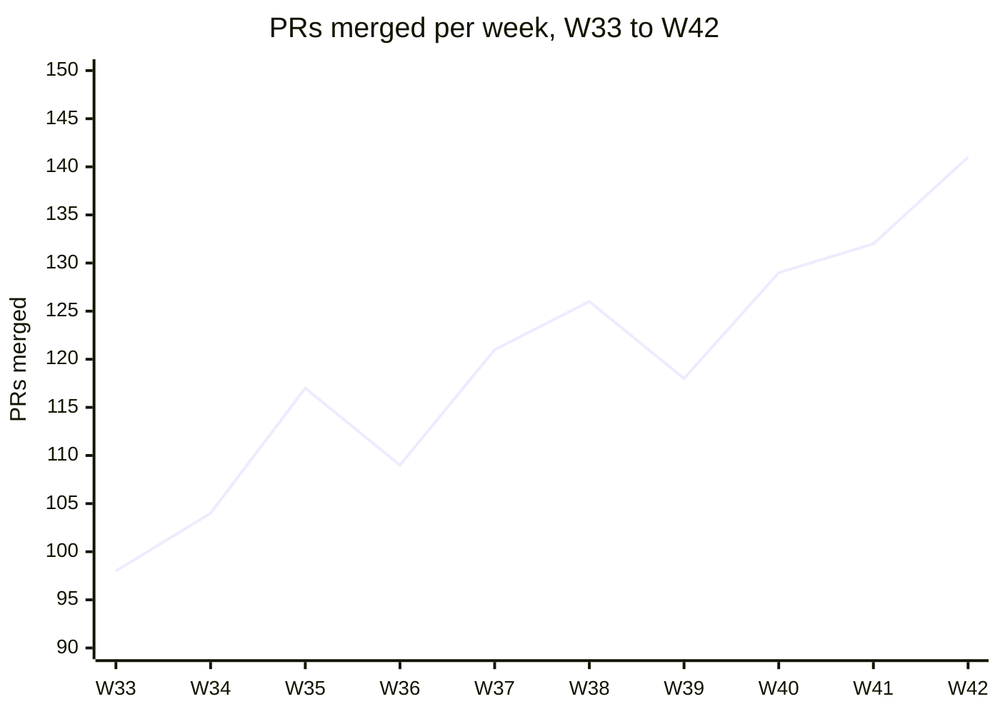

# Platform Engineering weekly status

Week ending 2026-10-16

| Deploys this week | PRs merged | Open incidents | On-call pages |
|:---:|:---:|:---:|:---:|
| **47** | **141** | **2** | **9** |

## Highlights

- The Postgres 16 upgrade finished on all 14 clusters.
- Build cache hit rate climbed to 87 percent.
- The new staging environment is live for the Checkout team.

## PRs merged per week

## Workstreams

| Workstream | Owner | Status | ETA |
|---|---|---|---|
| Postgres upgrade | Priya Nair | Done | 2026-10-09 |
| Service mesh rollout | Tomas Ruiz | On track | 2026-11-06 |
| Cost tagging | Mei Chen | On track | 2026-10-30 |
| Runner autoscaling | Dev Patel | Blocked | 2026-11-20 |

## Risks

> **Warning: runner autoscaling is blocked.** It waits on a quota increase from the cloud provider (ticket CASE-4471). If the increase is not approved by **2026-10-23**, the November date slips.
