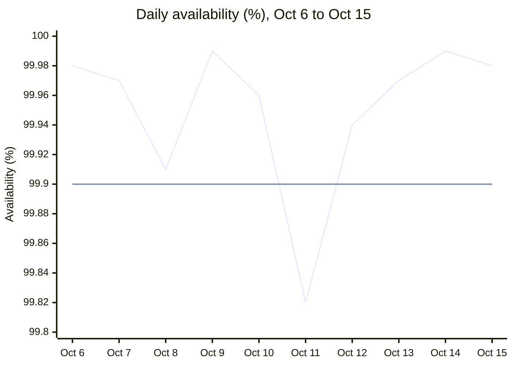
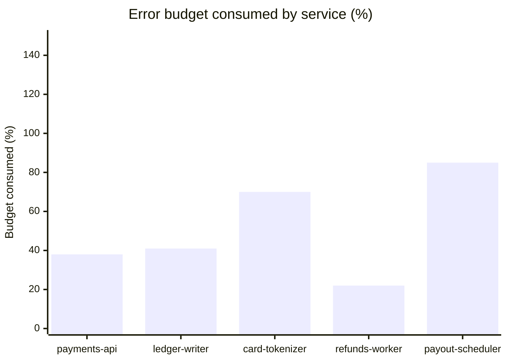

# Payments API SLO dashboard

Payments Reliability team. 30-day window ending 2026-10-15.

| Availability | Error budget remaining | p99 latency |
|:---:|:---:|:---:|
| **99.95%** (target 99.9) | **62%** | **412 ms** (target 500 ms) |

## Daily availability

Last ten days. The dashed-in target line sits at 99.9 percent. The Oct 11 dip (99.82 percent) is the only day that fell below it.

The first line series is the measured availability. The second, flat line at 99.9 is the SLO target.

## Service SLOs

| Service | SLO target | Current | Budget consumed |
|---|---:|---:|---:|
| payments-api | 99.9 | 99.95 | 38% |
| ledger-writer | 99.95 | 99.97 | 41% |
| card-tokenizer | 99.99 | 99.993 | 70% |
| refunds-worker | 99.5 | 99.71 | 22% |
| payout-scheduler | 99.9 | 99.92 | 85% |

