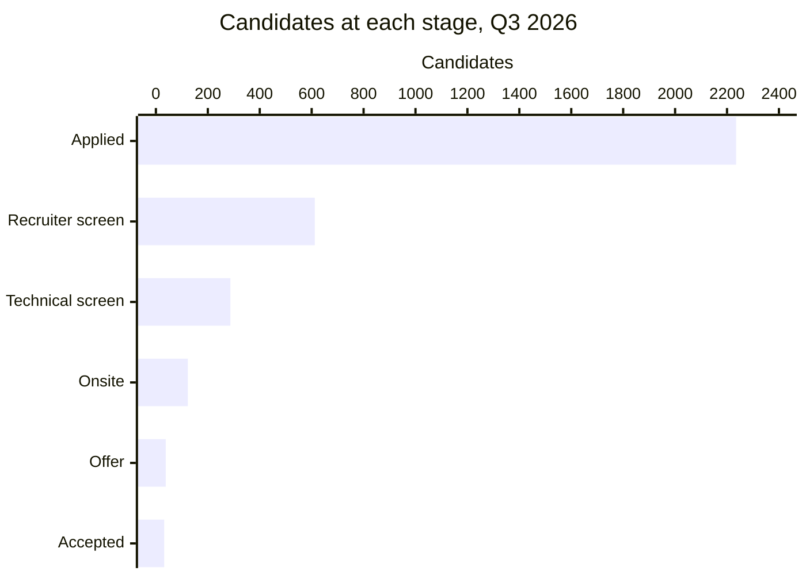
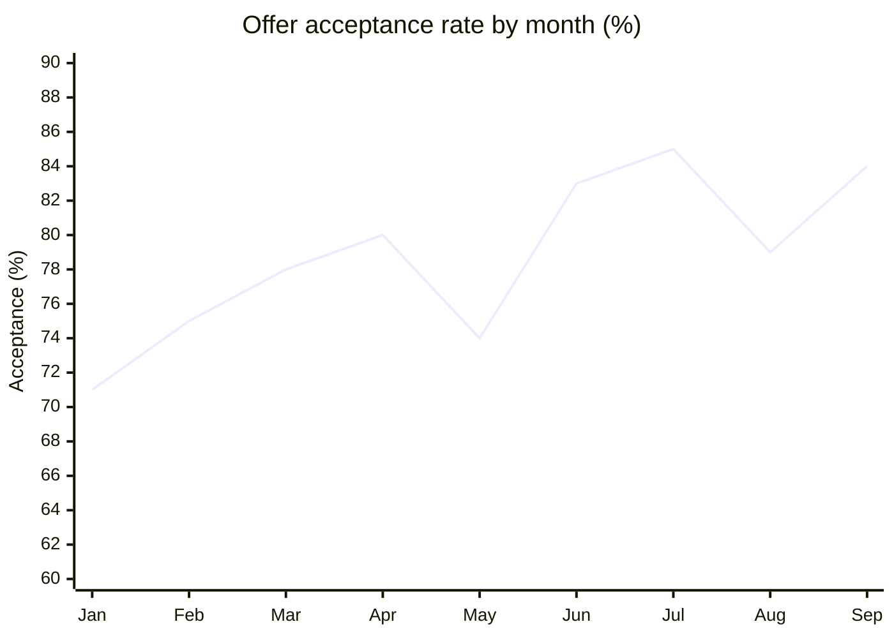

# Q3 2026 hiring funnel: Engineering

Lumen Health. Quarter ending September 2026.

| Applicants | Offers made | Offers accepted | Median time to hire |
|:---:|:---:|:---:|:---:|
| **2,235** | **38** | **32** | **34 days** |

## Funnel

Candidates at each stage.

## By role

| Role | Openings | Applicants | Onsites | Hires | Days open |
|---|---:|---:|---:|---:|---:|
| Backend Engineer | 6 | 840 | 44 | 12 | 41 |
| Frontend Engineer | 4 | 520 | 29 | 8 | 30 |
| Data Engineer | 3 | 410 | 25 | 6 | 37 |
| SRE | 2 | 230 | 14 | 3 | 52 |
| Engineering Manager | 2 | 140 | 7 | 2 | 66 |
| Security Engineer | 1 | 95 | 4 | 1 | 58 |

## Acceptance rate

Offer acceptance rate by month, in percent.

> **Longest-open roles.** SRE and Engineering Manager roles are taking the longest to fill. The team proposes a **$3,000 referral bonus** for those two roles, starting **2026-11-01**.
