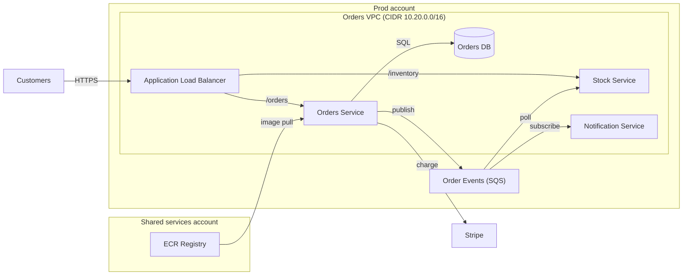

# Orders platform architecture

Owner: Commerce Platform team. Last reviewed 2026-10-01. Kestrel Outfitters.

## Overview

The Orders platform takes web orders, reserves stock and charges cards. At peak it handles about 3,200 orders per hour. Order writes go to a Postgres database, and order events flow to the Stock Service through a queue.

## Architecture diagram

## Components

| Component | Runtime | Purpose |
|---|---|---|
| Orders Service | ECS Fargate, 6 tasks | Accepts and records orders, charges cards |
| Stock Service | ECS Fargate, 4 tasks | Reserves stock against orders |
| Orders DB | RDS PostgreSQL 16 on db.r6g.xlarge, Multi-AZ | System of record for orders |
| Order Events | Standard SQS queue, 14 day retention | Carries order events to Stock |

## Failure modes

> **Warning: Orders DB failover.** A Multi-AZ failover of the Orders DB takes about 60 seconds. During that window, order writes fail and the storefront shows a retry banner.
