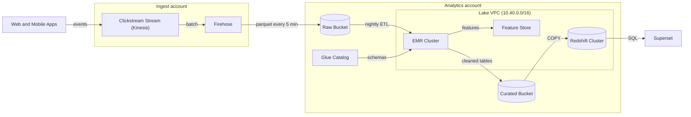

# Clickstream data platform

Data Engineering, Harbor Media. As of 2026-09-30.

## Overview

We collect about 1,800 million events per day from our apps. They land in a data lake that analysts query. Events stream through Kinesis and Firehose into raw storage, then get cleaned nightly and loaded into Redshift for reporting.

## Architecture diagram

## Datasets

| Dataset | Daily volume (GB) | Retention (days) | Owner |
|---|---:|---:|---|
| raw_events | 940 | 30 | Ingest squad |
| sessions | 120 | 400 | Analytics Eng |
| page_views | 310 | 400 | Analytics Eng |
| ad_impressions | 260 | 90 | Ad Tech |

## Known limits

- Firehose buffering means data arrives up to 5 minutes late.
- The nightly ETL finishes around 03:40 UTC.
- Redshift is a 4-node ra3.4xlarge cluster. It queues queries above 50 concurrent users.
