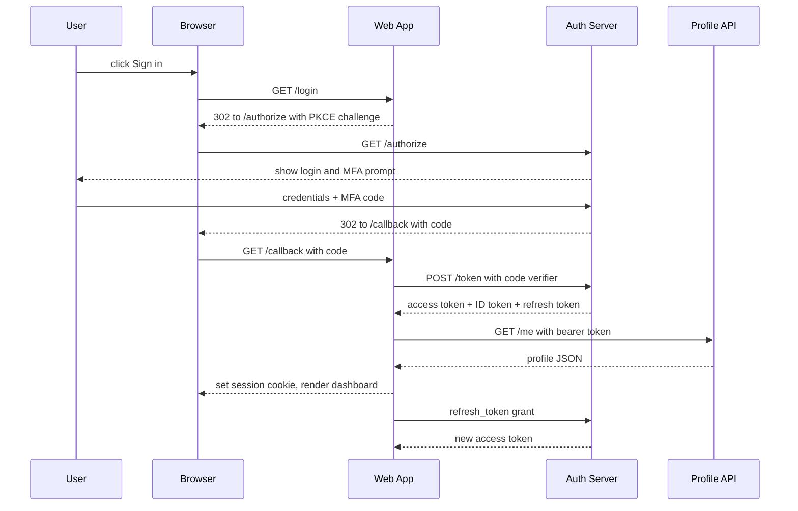

# How login works on the member portal

Pinecrest Credit Union. Identity team. Draft dated 2026-10-08.

## Login flow

## Tokens

| Token | Lifetime | Stored where |
|---|---|---|
| Access token | 15 minutes | Server-side session |
| ID token | 15 minutes | Server-side session |
| Refresh token | 30 days | Encrypted session store |
| Session cookie | 12 hours | Browser (HttpOnly, Secure) |

## Security notes

- PKCE is mandatory.
- MFA is required for every member.
- Failed logins lock the account after 5 attempts.

> **Warning:** Tokens must never be exposed to browser JavaScript or kept in browser storage.
