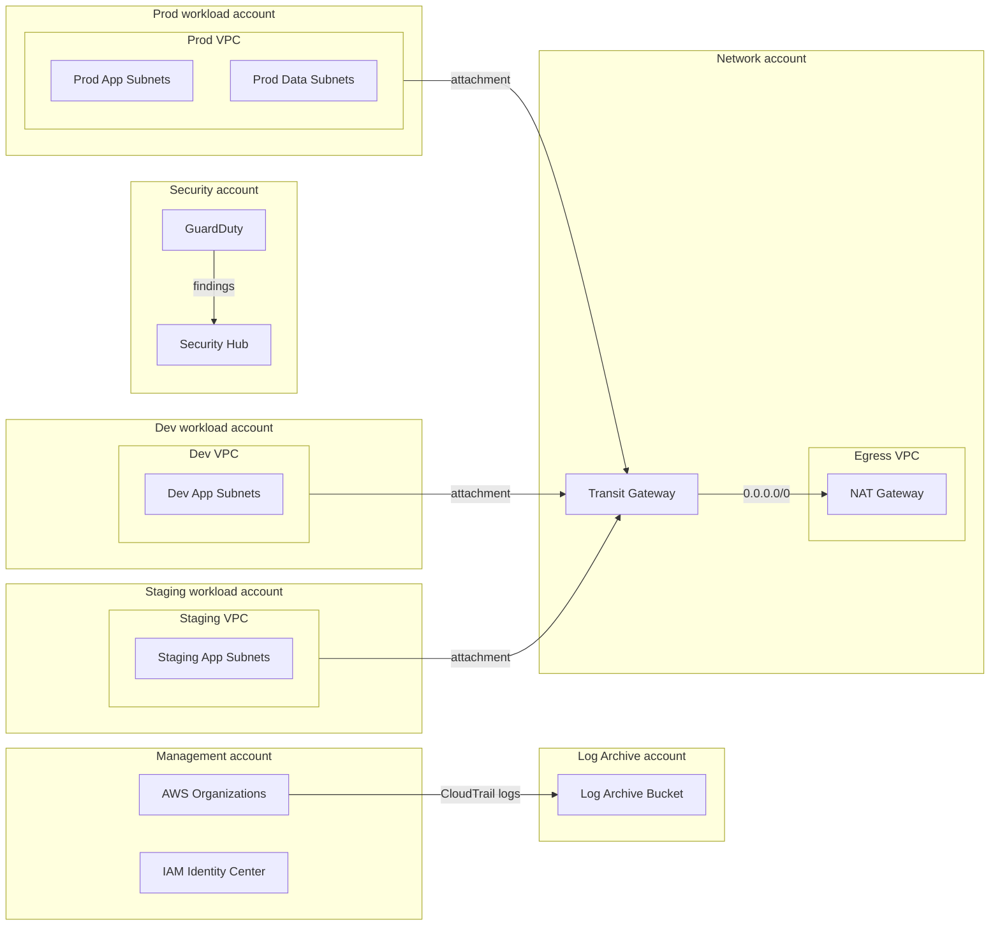

# AWS landing zone

Cloud Foundations team, Meridian Logistics. Documented as of 2026-10-05.

## Account structure

> **Note:** The Prod VPC and Dev VPC cannot route to each other. The Transit Gateway uses separate route tables, `rt-prod` and `rt-dev`.

## Network ranges

| VPC | Account | CIDR | Region |
|---|---|---|---|
| Egress VPC | Network | 10.0.0.0/20 | us-west-2 |
| Prod VPC | Prod workload | 10.10.0.0/16 | us-west-2 |
| Dev VPC | Dev workload | 10.20.0.0/16 | us-west-2 |
| Staging VPC | Staging workload | 10.30.0.0/16 | us-west-2 |

## Guardrails

Service control policies in force across the organization:

- Deny leaving the organization.
- Deny disabling CloudTrail.
- Deny regions other than us-west-2 and us-east-1.
- Deny root user access keys.
