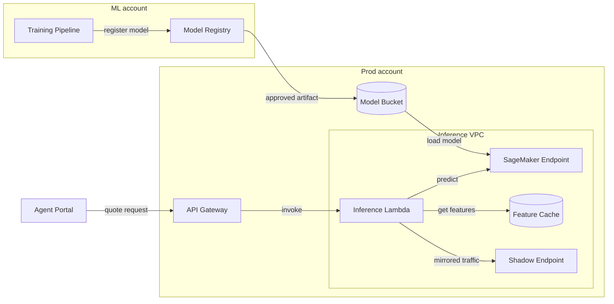

# Real-time quote pricing model architecture

ML Platform team, Orchard Insurance. Reviewed 2026-10-12.

## Overview

The service prices about 450 quotes per second at peak. Its p99 target is 250 ms. Quote requests come from the Agent Portal through an API Gateway to an inference Lambda, which calls a SageMaker endpoint. Models are trained and registered in a separate ML account, then promoted into production.

## Architecture diagram

## Capacity

| Component | Size | Scaling |
|---|---|---|
| SageMaker Endpoint | ml.c6i.2xlarge | 4 to 12 instances, based on invocations per instance |
| Inference Lambda | 1024 MB | 200 reserved concurrency |
| Feature Cache | cache.r7g.large | 2 replicas |
| Shadow Endpoint | ml.c6i.xlarge | 2 instances |

## Deployment

1. Register the model.
2. Approve it in the Model Registry.
3. Run a blue/green deploy, shifting 10 percent of traffic every 5 minutes.
4. Roll back automatically if p99 exceeds 250 ms.

> **Warning: the Feature Cache is not a source of truth.** A cache miss falls back to the policy database and adds about 90 ms to the request.
