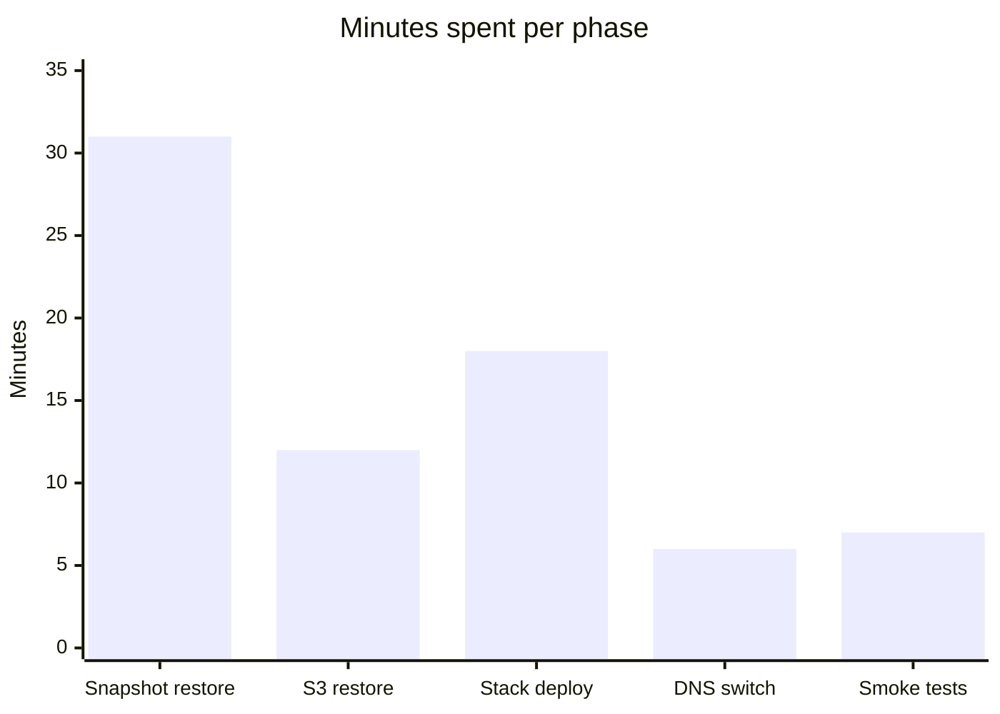

# Disaster recovery drill: patient-scheduling service, 2026-10-07

The Platform Resilience team at Bramble Health ran its quarterly disaster recovery drill on 2026-10-07. The drill simulated the loss of `us-west-2` and measured how long it took to bring the patient-scheduling service back in `us-east-2` from backups.

## Scope

- **Simulated failure:** total loss of the `us-west-2` region.
- **Recovery target:** the patient-scheduling service, restored in `us-east-2`.
- **Recovery sources:** the latest RDS snapshot and the replica of the S3 attachments bucket.

## Restore procedure

1. Freeze writes in `us-west-2`.
2. Restore the latest RDS snapshot in `us-east-2`.
3. Restore the S3 attachments bucket from the replica.
4. Deploy the service stack from the release tag.
5. Switch DNS for `scheduling.bramble.example` to `us-east-2`.
6. Run the smoke test suite.
7. Reopen writes.

> **Warning: confirm the snapshot timestamp before step 5.**
> Promoting an old snapshot silently loses appointments. Check that the restored snapshot's timestamp is the latest one before you switch DNS. If it is not, stop and restore the correct snapshot first.

## Results

| Metric | Target | Achieved |
| --- | --- | --- |
| RTO | 60 minutes | 74 minutes |
| RPO | 15 minutes | 9 minutes |
| Smoke tests passed | 48 of 48 | 46 of 48 |
| Data verified | 100 percent | 100 percent |

RTO missed its target by 14 minutes. RPO met its target with room to spare. Two smoke tests failed, and both depend on a `us-west-2`-only endpoint.

### Minutes spent per phase

The snapshot restore accounted for the largest share of the recovery time, at 31 minutes.

## Follow-ups

- Pre-provision the database subnet group in `us-east-2` to cut restore time.
- Fix the 2 smoke tests that depend on a `us-west-2`-only endpoint.
- Automate the DNS switch with a health-checked failover record.
- Next drill on 2027-01-20.
