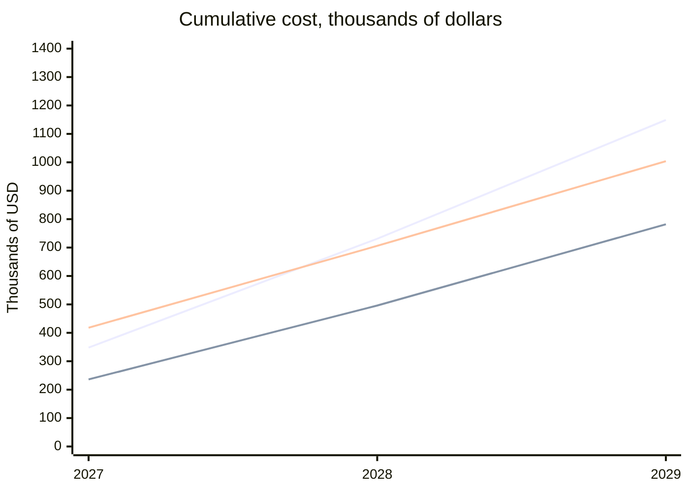

# Observability stack for 2027

Our SRE team at Copperleaf Insurance is choosing an observability stack for 2027. This page compares the options for the budget meeting.

## Current scale

- **Hosts:** 340
- **Logs ingested:** about 2.1 TB per month
- **On-call engineers:** 14

## Options

- **Datadog:** a hosted platform for metrics, logs and alerting.
- **Grafana Cloud:** a hosted Grafana stack built on Prometheus and Loki.
- **Self-hosted:** Prometheus, Loki and Grafana running on our own Kubernetes cluster.

## Comparison table

| Option | Setup effort | Alerting | Log search | Lock-in | Annual cost |
| --- | --- | --- | --- | --- | --- |
| Datadog | Low | Excellent | Excellent | High | $348,000 |
| Grafana Cloud | Low | Good | Good | Medium | $236,000 |
| Self-hosted | High | Good | Fair | Low | $148,000 plus 1.5 engineers |

## Three-year cost

Cumulative cost, in thousands of dollars. The series are Datadog, Grafana Cloud and Self-hosted (including staff time), in that order.

| Year | Datadog | Grafana Cloud | Self-hosted (with staff time) |
| --- | --- | --- | --- |
| 2027 | 348 | 236 | 418 |
| 2028 | 731 | 496 | 706 |
| 2029 | 1,149 | 782 | 1,004 |

## Pros and cons

### Datadog

- Pros
  - Excellent alerting and log search.
  - Little setup work.
- Cons
  - Highest annual cost.
  - High lock-in.

### Grafana Cloud

- Pros
  - Low setup effort.
  - Keeps our dashboards portable.
- Cons
  - Log search is good but not as strong as Datadog's.
  - Medium lock-in.

### Self-hosted

- Pros
  - Lowest licence-free cost and low lock-in.
  - Full control over data and retention.
- Cons
  - High setup effort.
  - Needs about 1.5 engineers to run.
  - Fair log search.

## Recommendation

Grafana Cloud. It is the cheapest option once staff time is counted, and it keeps our dashboards portable.

> **Note: two assumptions to check before the meeting.**
>
> - The Datadog quote expires on 2026-11-30.
> - The Self-hosted figures assume we can hire the 1.5 engineers. That hire is not yet approved.
