# CI provider comparison for firmware and cloud repos

Developer Experience at Ridgeback Robotics is replacing Jenkins. This page compares CI providers for the firmware and cloud repos.

## Context

- **Build volume:** about 38,000 build minutes per month
- **Engineers:** 120
- **Special needs:** some jobs need ARM runners, and some need a hardware-in-the-loop lab

## Options

- **GitHub Actions**
- **CircleCI**
- **Buildkite**

## Comparison

| Provider | Median build time (min) | ARM runners | Self-hosted agents | Monthly cost |
| --- | --- | --- | --- | --- |
| GitHub Actions | 14.2 | Yes | Yes | $2,860 |
| CircleCI | 11.8 | Yes | Yes | $3,420 |
| Buildkite | 9.6 | Via our own agents | Yes (required) | $2,150 plus our compute |

## Benchmarks

Median build time, in minutes, for our four reference pipelines on each provider.

```mermaid
xychart-beta
    title "Median build time by pipeline (minutes)"
    x-axis ["firmware-build", "cloud-api-tests", "docs-site", "sim-regression"]
    y-axis "Minutes" 0 --> 40
    bar [21.4, 9.8, 3.1, 34.5]
    bar [17.9, 8.1, 2.7, 29.0]
    bar [13.2, 7.4, 2.9, 22.6]
```

The three bars at each pipeline are GitHub Actions, CircleCI and Buildkite, in that order.

| Pipeline | GitHub Actions | CircleCI | Buildkite |
| --- | --- | --- | --- |
| firmware-build | 21.4 | 17.9 | 13.2 |
| cloud-api-tests | 9.8 | 8.1 | 7.4 |
| docs-site | 3.1 | 2.7 | 2.9 |
| sim-regression | 34.5 | 29.0 | 22.6 |

## Pros and cons

### GitHub Actions

- Pros
  - ARM runners and self-hosted agents are both available.
  - Lowest-cost option on our build mix after Buildkite's compute is excluded.
- Cons
  - Slowest on the firmware pipeline.

### CircleCI

- Pros
  - ARM runners and self-hosted agents are both available.
  - Faster than GitHub Actions on every pipeline.
- Cons
  - Highest monthly cost.
  - Slower than Buildkite on every pipeline.

### Buildkite

- Pros
  - Fastest on the firmware and cloud pipelines.
  - Self-hosted agents suit the hardware-in-the-loop lab.
- Cons
  - ARM runners come through our own agents.
  - We run the agents ourselves, so it needs more operational work.

## Recommendation

> **Recommendation: Buildkite.**
>
> The hardware-in-the-loop lab needs self-hosted agents anyway, and Buildkite was the fastest provider on our reference pipelines.

> **Warning: runner patching moves to DevEx on-call.**
>
> Buildkite moves runner patching onto the DevEx on-call. We estimate that at 6 hours a month.
