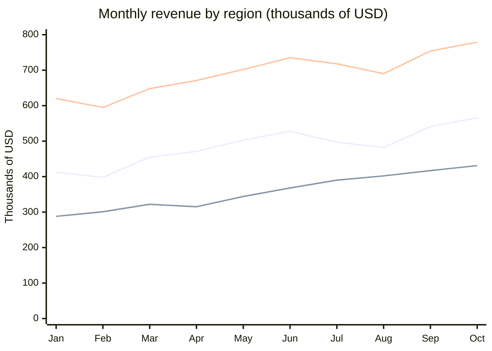

# Vantage Outdoor Gear: 2026 revenue by region, January to October

This page summarizes revenue by region for Vantage Outdoor Gear from January to October 2026. All figures are in thousands of dollars.

## Headline figures

- **Year-to-date revenue:** $15,343K
- **Best month:** October, at $1,776K
- **APAC growth, January to October:** 49.7 percent
- **Americas share:** 45.0 percent

> **Note: figures are unaudited.**
> These figures are unaudited and exclude the wholesale channel.

## Monthly revenue

The three lines are EMEA, APAC and Americas, in that order.

## Revenue table

All values are in thousands of dollars.

| Month | EMEA | APAC | Americas | Total |
| --- | --- | --- | --- | --- |
| Jan | 412 | 288 | 620 | 1,320 |
| Feb | 398 | 301 | 595 | 1,294 |
| Mar | 455 | 322 | 648 | 1,425 |
| Apr | 471 | 315 | 671 | 1,457 |
| May | 503 | 344 | 702 | 1,549 |
| Jun | 528 | 368 | 735 | 1,631 |
| Jul | 497 | 390 | 718 | 1,605 |
| Aug | 482 | 402 | 690 | 1,574 |
| Sep | 541 | 417 | 754 | 1,712 |
| Oct | 566 | 431 | 779 | 1,776 |

## Highlights

- APAC was the fastest-growing region, up 49.7 percent from January to October.
- EMEA dipped in July and August because of the summer sales holiday.
- October was the record month, at $1,776K.
