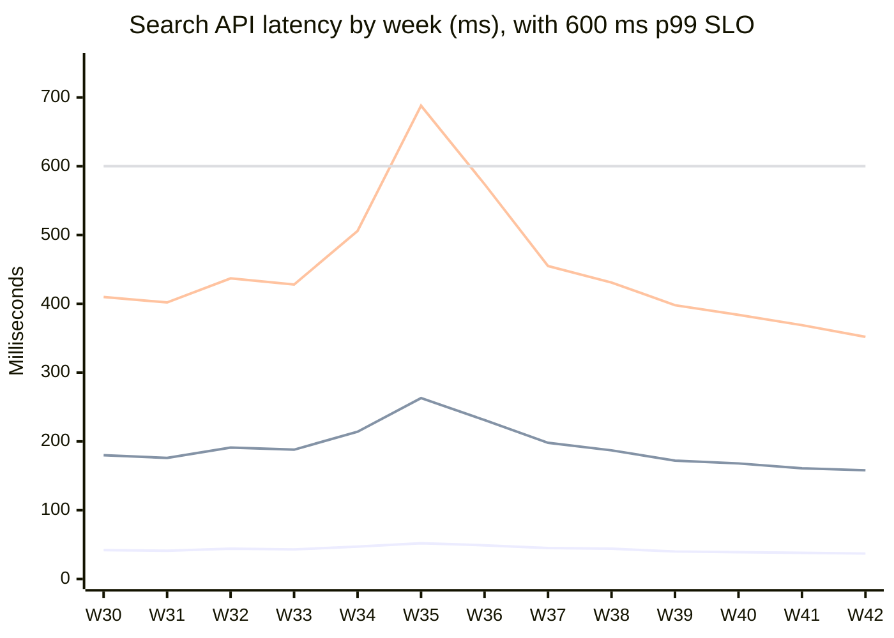

# Search API latency, weeks W30 to W42 of 2026

The Search team at Fieldnote Maps tracks latency for the search API. This report covers weeks W30 to W42 of 2026, in milliseconds.

## Latest week (W42)

- **p50:** 37 ms
- **p95:** 158 ms
- **p99:** 352 ms
- **SLO compliance:** 12 of 13 weeks (the SLO is p99 under 600 ms)

## Latency trend

The SLO threshold of 600 ms is the dashed reference line at the top of the chart.

The four lines are p50, p95, p99 and the 600 ms SLO, in that order.

## Weekly data

| Week | p50 | p95 | p99 |
| --- | --- | --- | --- |
| W30 | 42 | 180 | 410 |
| W31 | 41 | 176 | 402 |
| W32 | 44 | 191 | 437 |
| W33 | 43 | 188 | 428 |
| W34 | 47 | 214 | 506 |
| W35 | 52 | 263 | 688 |
| W36 | 49 | 231 | 574 |
| W37 | 45 | 198 | 455 |
| W38 | 44 | 187 | 431 |
| W39 | 40 | 172 | 398 |
| W40 | 39 | 168 | 384 |
| W41 | 38 | 161 | 369 |
| W42 | 37 | 158 | 352 |

## What changed

Latency rose in W35 after the index migration to the new cluster. It recovered once query caching shipped in W37.

> **W35 is the only week that breached the SLO.**
> Its p99 of 688 ms was over the 600 ms target. Every other week stayed under it.
