# 2026 engagement survey results

People Ops at Hollow Creek Software ran the 2026 engagement survey, which closed on 2026-09-26.

## Headline figures

- **Response rate:** 87 percent (412 of 474 employees)
- **Overall engagement:** 74 percent favorable
- **eNPS:** 31

## Results by question

Percent favorable, 2025 compared with 2026. The bars for each question are 2025 and then 2026.

```mermaid
xychart-beta
    title "Percent favorable, 2025 vs 2026"
    x-axis ["Strategy", "Growth", "Tools", "Workload", "Recommend", "Communication", "Safe to raise concerns"]
    y-axis "Percent favorable" 0 --> 90
    bar [61, 70, 64, 52, 73, 49, 66]
    bar [72, 76, 59, 48, 79, 58, 71]
```

| Question | 2025 | 2026 |
| --- | --- | --- |
| I understand our strategy | 61 | 72 |
| My manager supports my growth | 70 | 76 |
| I have the tools to do my job | 64 | 59 |
| Workload is sustainable | 52 | 48 |
| I would recommend working here | 73 | 79 |
| Decisions are communicated well | 49 | 58 |
| I feel safe raising concerns | 66 | 71 |

## By department

| Department | Responses | Response rate | Engagement |
| --- | --- | --- | --- |
| Engineering | 168 | 89 percent | 71 percent |
| Sales | 92 | 81 percent | 77 percent |
| Support | 74 | 90 percent | 69 percent |
| Operations | 48 | 86 percent | 80 percent |
| G&A | 30 | 88 percent | 83 percent |

## Focus areas

- **Tools:** down from 64 to 59 percent favorable.
- **Workload:** down from 52 to 48 percent favorable.

> **Support has the lowest engagement.**
> A listening session is set for 2026-10-28.

Comments are anonymous, so this page does not quote any individual responses.
