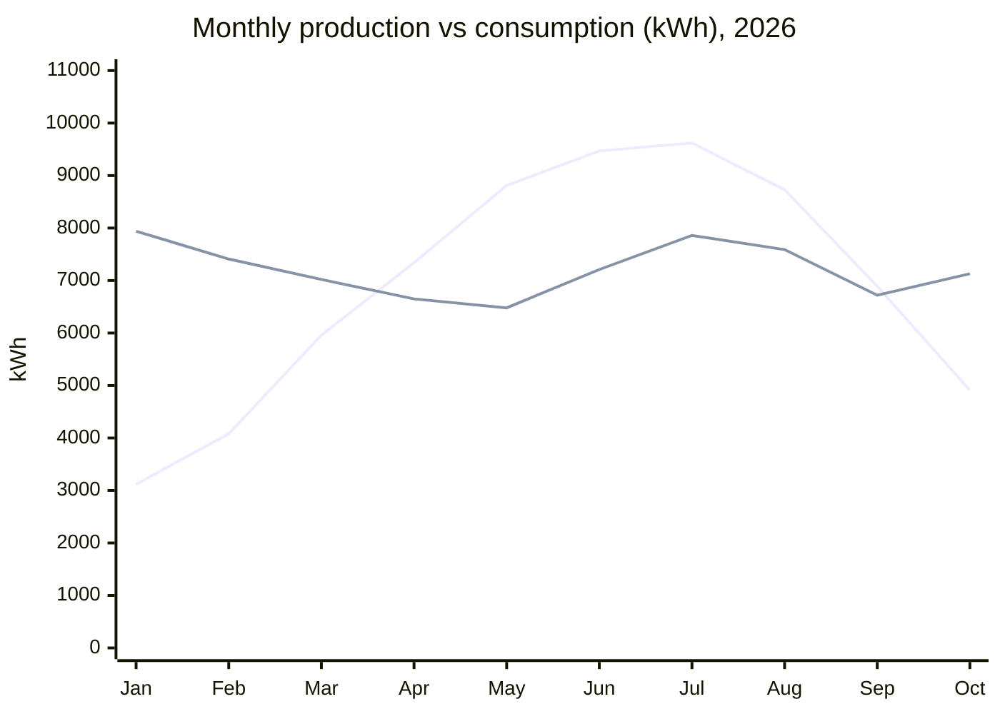

# Rooftop solar, January to October 2026

The facilities team at the Brookfield Community Co-op reports on our rooftop solar array for the first ten months of 2026. All figures are in kWh.

## Headline figures

- **Total produced:** 68,930 kWh
- **Total consumed:** 72,010 kWh
- **Self-sufficiency:** 95.7 percent
- **Grid credits earned:** $1,184

## Production vs consumption

The two lines are produced and consumed, in that order.

## Monthly detail

Net is produced minus consumed. Months with a surplus are marked with a check.

| Month | Produced | Consumed | Net | Surplus |
| --- | --- | --- | --- | --- |
| Jan | 3,120 | 7,940 | -4,820 | |
| Feb | 4,080 | 7,410 | -3,330 | |
| Mar | 5,960 | 7,020 | -1,060 | |
| Apr | 7,340 | 6,650 | +690 | Yes |
| May | 8,810 | 6,480 | +2,330 | Yes |
| Jun | 9,470 | 7,210 | +2,260 | Yes |
| Jul | 9,620 | 7,860 | +1,760 | Yes |
| Aug | 8,730 | 7,590 | +1,140 | Yes |
| Sep | 6,890 | 6,720 | +170 | Yes |
| Oct | 4,910 | 7,130 | -2,220 | |

## Notes

The inverter was down for 4 days in March, which reduced that month's production.

> **Board vote on battery storage: 2026-11-12.**
> The board will vote on adding battery storage on this date.
