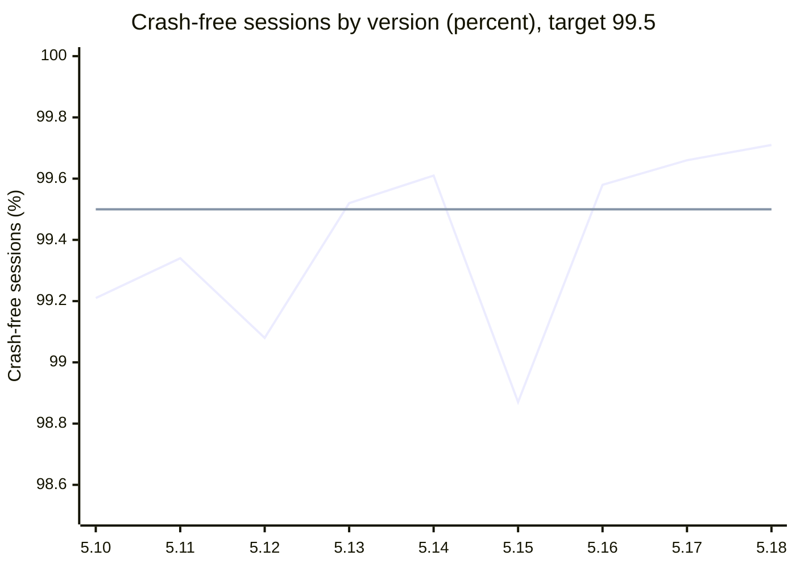

# Courier Android app: stability across releases

The Mobile Platform team at Sprocket Delivery tracks stability for the courier Android app across releases. This report covers versions 5.10 to 5.18.

## Current release

- **Current version:** 5.18
- **Crash-free sessions:** 99.71 percent
- **Target:** 99.5 percent
- **ANR rate:** 0.21 percent

## Crash-free trend

The target of 99.5 percent is the reference line on the chart.

The two lines are crash-free sessions and the 99.5 percent target, in that order.

## Release table

| Version | Released | Crash-free sessions | Top crash |
| --- | --- | --- | --- |
| 5.10 | 2026-05-04 | 99.21% | None above 0.1 percent |
| 5.11 | 2026-05-25 | 99.34% | None above 0.1 percent |
| 5.12 | 2026-06-15 | 99.08% | Camera permission crash on the proof-of-delivery screen |
| 5.13 | 2026-07-06 | 99.52% | None above 0.1 percent |
| 5.14 | 2026-07-27 | 99.61% | None above 0.1 percent |
| 5.15 | 2026-08-17 | 98.87% | Offline map tile cache overflow |
| 5.16 | 2026-09-07 | 99.58% | None above 0.1 percent |
| 5.17 | 2026-09-28 | 99.66% | None above 0.1 percent |
| 5.18 | 2026-10-19 | 99.71% | Not yet available |

## Top issues

- **Version 5.12:** a camera permission crash on the proof-of-delivery screen.
- **Version 5.15:** an offline map tile cache overflow.

> **Version 5.15 was halted and replaced.**
> It was halted at a 20 percent rollout. Version 5.16 replaced it three weeks later.
