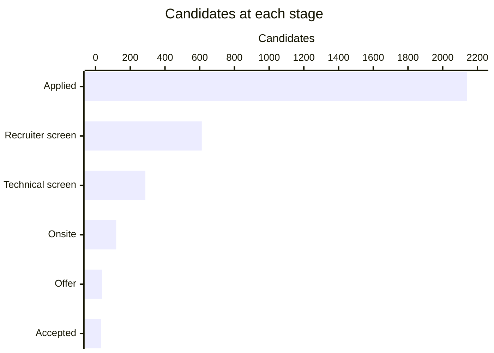
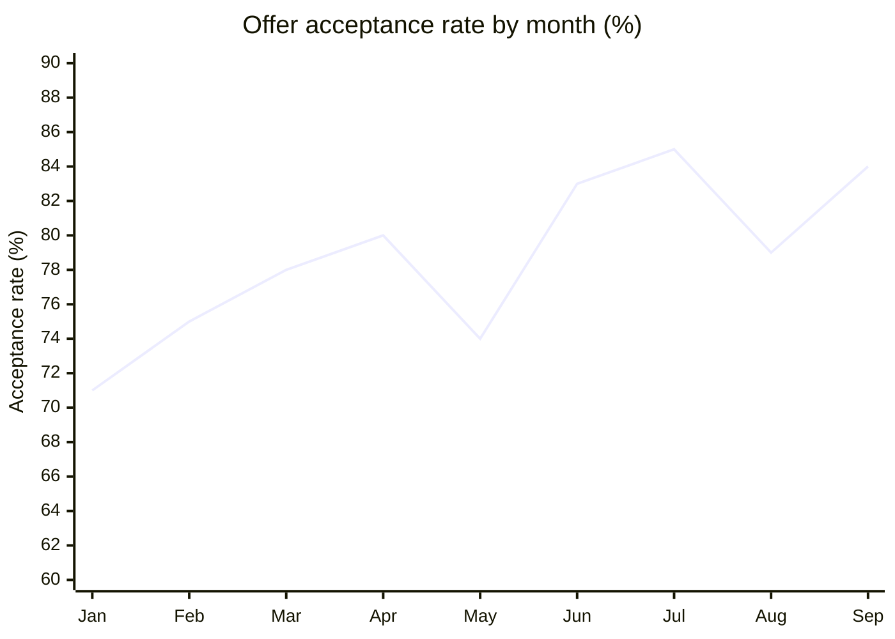

# Q3 2026 Engineering Hiring Funnel

**Lumen Health** · Engineering org

| Applicants | Offers made | Offers accepted | Median time to hire |
| :---: | :---: | :---: | :---: |
| **2,140** | **38** | **31** | **34 days** |

## Funnel

| Stage | Candidates | Share of applicants |
| --- | ---: | ---: |
| Applied | 2,140 | 100% |
| Recruiter screen | 612 | 28.6% |
| Technical screen | 287 | 13.4% |
| Onsite | 119 | 5.6% |
| Offer | 38 | 1.8% |
| Accepted | 31 | 1.4% |

## By role

| Role | Openings | Applicants | Onsites | Hires | Days open |
| --- | ---: | ---: | ---: | ---: | ---: |
| Backend Engineer | 6 | 840 | 44 | 12 | 41 |
| Frontend Engineer | 4 | 520 | 29 | 8 | 30 |
| Data Engineer | 3 | 410 | 25 | 6 | 37 |
| SRE | 2 | 230 | 14 | 3 | **52** |
| Engineering Manager | 2 | 140 | 7 | 2 | **66** |
| Security Engineer | 1 | 95 | 4 | 1 | **58** |

## Acceptance rate

> **Proposal:** SRE and Engineering Manager roles are taking the longest to fill. The team proposes a **$3,000 referral bonus** for those two roles starting **2026-11-01**.
