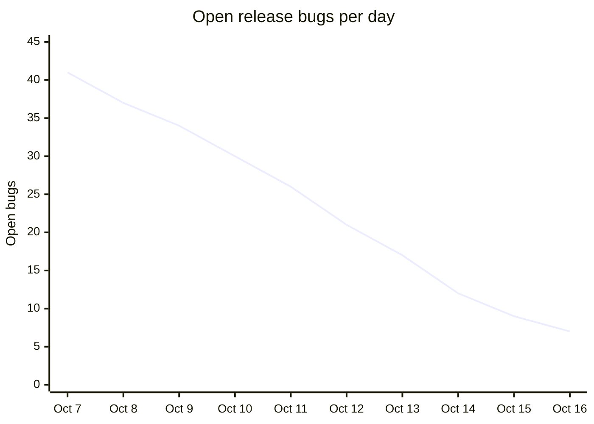

# Atlas 4.2.0 Go/No-Go

> **Recommendation: Go**
>
> Go for release on **2026-10-22**.

Mobile app release 4.2.0 · Target date 2026-10-22 · Owned by the Release Council

| Open blockers | Crash-free sessions (beta) | Test pass rate | Days to release |
| :---: | :---: | :---: | :---: |
| **1** | **99.71%** | **96.4%** | **6** |

## Readiness checklist

| Area | Owner | Status | Notes |
| --- | --- | --- | --- |
| Feature complete | Ana Brooks | Ready | All 12 epics merged |
| Regression suite | QA Guild | Ready | 1,842 of 1,911 tests passing |
| Accessibility audit | Kofi Mensah | Ready | Contrast issues resolved |
| Localization | Ines Duarte | Ready | 14 languages signed off |
| Store listing | Growth team | **Not ready** | Tablet screenshots pending |
| Rollback plan | Ana Brooks | Ready | Staged rollout starting at 5% |

## Bug burndown

## Blockers

1. **Store listing:** tablet screenshots are missing.
