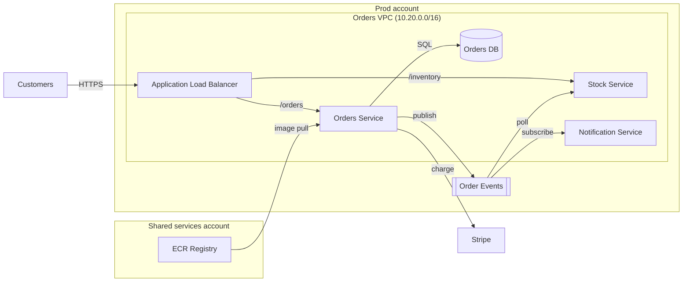

# Orders Platform Architecture

**Kestrel Outfitters** · Owned by the Commerce Platform team · Last reviewed 2026-10-01

## Overview

The Orders platform takes web orders, reserves stock and charges customers' cards. It handles about **3,200 orders per hour** at peak. Orders flow through a load balancer to two Fargate services, with an SQS queue decoupling order placement from inventory updates.

## Architecture diagram

## Components

| Component | Runtime | Purpose |
| --- | --- | --- |
| Orders Service | ECS Fargate, 6 tasks | Accepts orders, writes them to the database, charges cards via Stripe and publishes order events |
| Stock Service | ECS Fargate, 4 tasks | Serves inventory requests and reserves stock from queued order events |
| Orders DB | RDS PostgreSQL 16, db.r6g.xlarge, Multi-AZ | System of record for orders |
| Order Events | SQS standard queue, 14-day retention | Decouples order placement from stock reservation |

## Failure modes

> **Warning: Orders DB failover**
>
> A Multi-AZ failover of the Orders DB takes about **60 seconds**. During that window order writes fail and the storefront shows a retry banner.
