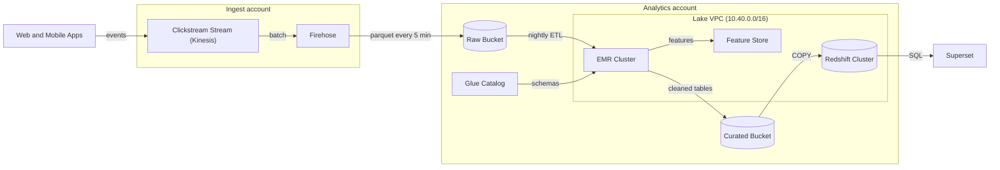

# Clickstream Data Platform

**Harbor Media** · Data Engineering team · as of 2026-09-30

## Overview

We collect about **1.8 billion events per day** (1,800 million) from our web and mobile apps. Events are streamed through Kinesis, batched by Firehose into Parquet files in a raw S3 bucket, cleaned by a nightly EMR job, and loaded into Redshift. Analysts query the lake from there, mostly through Superset.

## Architecture diagram

## Datasets

| Dataset | Daily volume (GB) | Retention (days) | Owner |
| --- | ---: | ---: | --- |
| raw_events | 940 | 30 | Ingest squad |
| sessions | 120 | 400 | Analytics Eng |
| page_views | 310 | 400 | Analytics Eng |
| ad_impressions | 260 | 90 | Ad Tech |

## Known limits

- **Up to 5 minutes late:** Firehose buffering means data can arrive up to 5 minutes after the event.
- **Nightly ETL lands around 03:40 UTC:** curated tables are not fresh before then.
- **Redshift concurrency:** the 4-node ra3.4xlarge cluster queues queries above 50 concurrent users.
