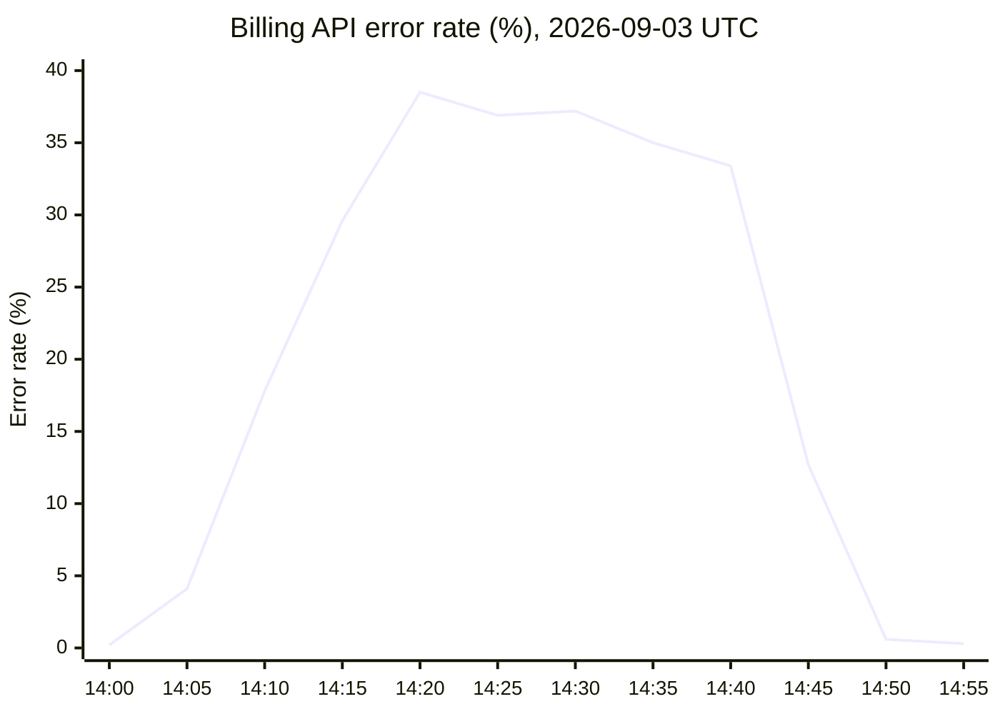

# Postmortem: INC-2291 Billing API Outage

**Brightwave Telecom** · Billing Platform team · Incident date 2026-09-03 · Severity Sev2

| Duration | Peak error rate | Failed requests | Customers affected |
| :---: | :---: | :---: | :---: |
| **47 min** | **38.5%** | **182,400** | **13,150** |

## Summary

A configuration change lowered the Billing API's database connection pool from **200 to 20** connections. With too few connections to serve normal traffic, requests queued waiting for a connection and timed out, pushing the error rate as high as 38.5%. The change was rolled back, and errors returned to baseline 47 minutes after the deploy.

## Timeline

| Time (UTC) | Event |
| --- | --- |
| 14:02 | Config change merged and deployed |
| 14:06 | Error rate alert fires |
| 14:09 | On-call acknowledges |
| 14:21 | Incident declared Sev2 |
| 14:33 | Connection pool exhaustion identified |
| 14:41 | Rollback started |
| 14:49 | Errors return to baseline |
| 14:53 | Incident resolved |

## Error rate

## Root cause

The connection pool size is set in service config, and the change that dropped it to 20 passed review and deployed to every pod at once. At normal load the service needs far more than 20 concurrent database connections, so the pool was exhausted within minutes and each request waited in a queue until it hit its timeout. Nothing in the pipeline compared the new value against a sane range, and there was no alert on pool saturation, so the cause took 31 minutes to identify after the deploy.

> **Contributing factor:** the config linter did not validate pool size bounds, so a value of 20 passed checks unchallenged.

## Action items

| Action | Owner | Due |
| --- | --- | --- |
| Add bounds validation for pool settings | Marta Kowalski | 2026-09-24 |
| Canary config changes to 5% of pods first | Ravi Shah | 2026-10-08 |
| Alert on pool saturation above 80% | Billing on-call | 2026-09-17 |
| Write a runbook for connection pool exhaustion | Lena Fischer | 2026-10-15 |
