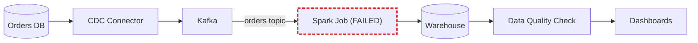

# Postmortem: Late Daily Sales Dashboards

**Juniper Retail** · Analytics Platform team · Incident date 2026-10-02

The daily sales dashboards, normally ready by **02:00**, were **9 hours late**.

## Impact

- **9 hours** of delay to the daily sales data.
- **23 dashboards** stale.
- The **08:00 executive sales report** went out with the previous day's numbers.

## Pipeline

The **Spark Job** is the component that failed.

## Timeline

| Time | Event |
| --- | --- |
| 01:00 | Nightly Spark Job starts |
| 01:47 | Spark Job fails with out-of-memory on the orders partition for 2026-10-01 |
| 02:30 | Automatic retry also fails |
| 07:55 | Analyst reports stale dashboards |
| 08:20 | On-call doubles executor memory to 16 GB and reruns |
| 10:05 | Spark Job succeeds |
| 10:58 | Dashboards refreshed |

## Root cause

A promotion on 2026-10-01 produced **3.4 times** the normal order volume: **4.1 million orders** against a typical 1.2 million. The Spark Job's executors were sized at **8 GB** each, which fits a normal day but not that partition, so the job ran out of memory. The automatic retry used the same memory settings and failed the same way, and because nobody was paged, the failure sat unnoticed until an analyst reported it nearly six hours later.

## Lessons learned

**What went well**

- Once on-call was engaged, the cause was found and fixed quickly: doubling executor memory to 16 GB made the rerun succeed.
- The rest of the pipeline (CDC, Kafka, Warehouse) was unaffected, so no data was lost.

**What did not go well**

- Two consecutive failures paged no one; the incident was detected by a user.
- Executor memory was a fixed value with no link to input volume.
- Dashboards gave no sign the data was stale, so the executive report went out with yesterday's numbers.

## Action items

1. Page on-call when the nightly job fails twice.
2. Size executor memory from the input volume.
3. Add a data freshness banner to dashboards.
4. Alert when the job input exceeds 2.5 times the 30-day average.
