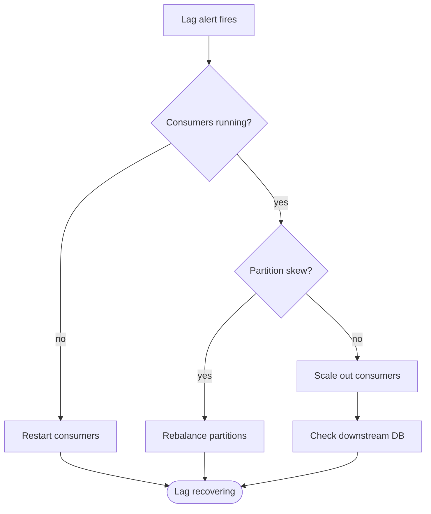

# Runbook: settlement-consumer Lag Alert

**Corvid Payments** · Streaming team · Consumer group `settlement-consumer` on topic `payments-events`

## Alert thresholds

| Severity | Lag (messages) | Duration | Action |
| --- | ---: | --- | --- |
| Warning | 50,000 | 10 minutes | Slack only |
| Critical | 150,000 | 5 minutes | Page on-call |
| Emergency | 1,000,000 | Any | Page on-call and the Streaming lead |

## Triage flow

## Steps

1. Check the consumer pods in the **`streaming`** namespace.
2. Check per-partition lag.
3. If one partition holds **more than 40%** of the lag, treat it as skew.
4. Scale the deployment to **at most 24 replicas**. The topic has 24 partitions, so extra replicas would sit idle.

> **Warning: never reset consumer offsets to latest.**
>
> Unprocessed settlements would be skipped and would have to be reconciled by hand.

## Escalation

If lag is **still growing after 30 minutes**, escalate to the Streaming lead.
