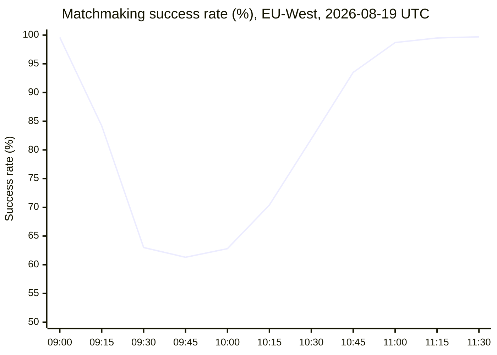

# Postmortem: INC-3107 EU Matchmaking DNS Outage

**Alder Cloud Games** · Network team · Incident date 2026-08-19

| Duration | Lowest success rate | Matches failed | Region |
| :---: | :---: | :---: | :---: |
| **1 h 52 min** | **61.3%** | **48,200** | **EU-West** |

## What happened

A Terraform change replaced the weighted DNS records for `match.eu` with a single record pointing at a decommissioned load balancer, so players in Europe could not reach matchmaking. The record was restored at 10:11 UTC, 59 minutes after the apply, but recovery took almost another hour: negative caching with a TTL of **3,600 seconds** meant resolvers kept serving the failed answer long after the fix was in place.

## Timeline

| Time (UTC) | Event |
| --- | --- |
| 09:12 | Terraform apply |
| 09:15 | Success rate drops |
| 09:31 | Player reports spike on social media |
| 09:40 | Incident declared |
| 10:05 | Bad record identified |
| 10:11 | Record restored |
| 11:04 | Success rate back above 99%; incident resolved |

## Request success rate

## Action items

- Require a plan review for DNS changes.
- Lower the negative cache TTL to **300 seconds**.
- Add synthetic matchmaking checks from three EU cities.
- Alert when weighted record count drops to one.
