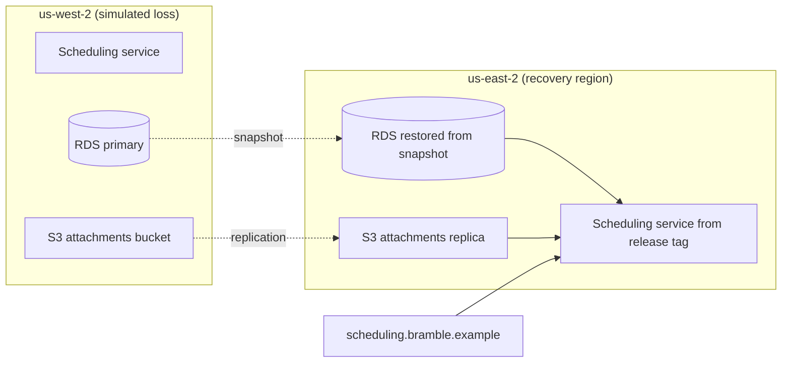
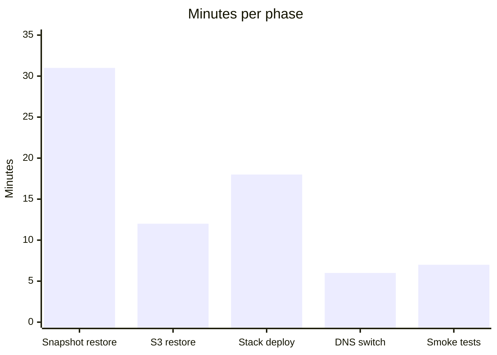

# Q4 2026 Disaster Recovery Drill: Patient Scheduling

**Bramble Health · Platform Resilience team · Drill date: 2026-10-07**

This page is both the runbook we followed and the record of how the drill went. RPO and data verification met target; RTO came in 14 minutes over, and 2 of 48 smoke tests failed.

| | |
|---|---|
| **RTO** | 74 min achieved (target 60) |
| **RPO** | 9 min achieved (target 15) |
| **Smoke tests** | 46 of 48 passed |
| **Data verified** | 100 percent |

## Scope

Restore the patient-scheduling service in **us-east-2** from backups after simulating the complete loss of **us-west-2**.

## Restore procedure

1. Freeze writes in us-west-2.
2. Restore the latest RDS snapshot in us-east-2.
3. Restore the S3 attachments bucket from the replica.
4. Deploy the service stack from the release tag.

> **Warning:** Confirm the snapshot timestamp before switching DNS. Promoting an old snapshot silently loses appointments, and nothing downstream will flag it.

5. Switch DNS for `scheduling.bramble.example` to us-east-2.
6. Run the smoke test suite.
7. Reopen writes.

## Results

| Metric | Target | Achieved |
|---|---|---|
| RTO | 60 minutes | 74 minutes |
| RPO | 15 minutes | 9 minutes |
| Smoke tests passed | 48 of 48 | 46 of 48 |
| Data verified | 100 percent | 100 percent |

### Minutes spent per phase

Snapshot restore took 31 of the 74 minutes, more than any other phase and the main reason we missed RTO.

## Follow-ups

- Pre-provision the database subnet group in us-east-2 to cut restore time.
- Fix the 2 smoke tests that depend on a us-west-2-only endpoint.
- Automate the DNS switch with a health-checked failover record.
- Next drill on **2027-01-20**.
