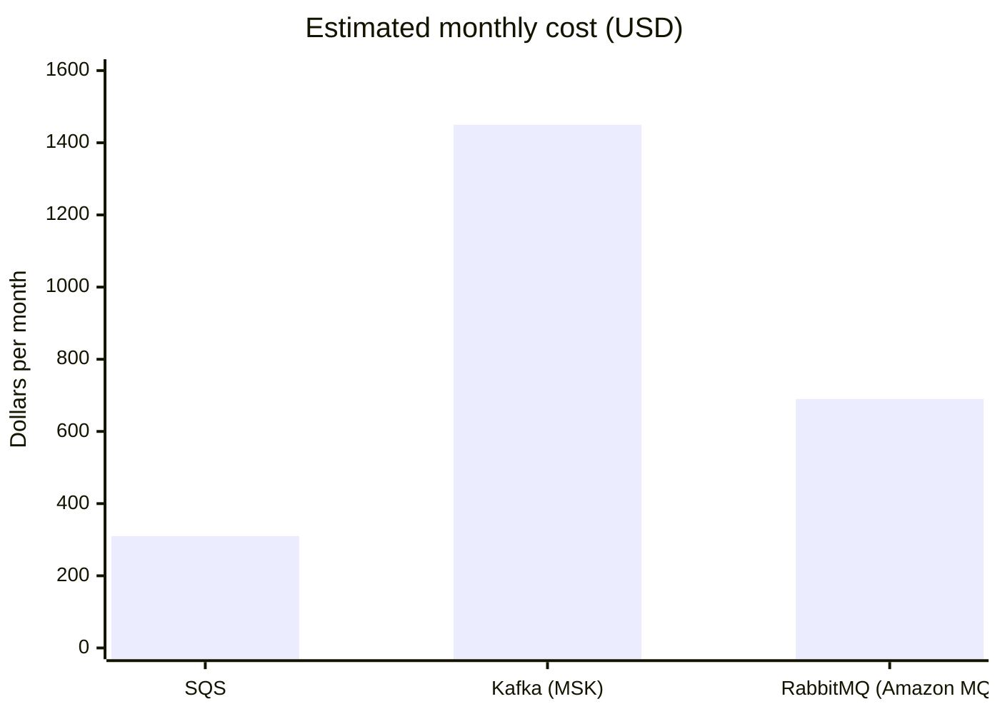

# Message Queue for Order Routing

**Saltmarsh Foods · Fulfillment team · For architecture review on 2026-10-21**

> **Recommendation:** Kafka (Amazon MSK), partitioned by order ID. It meets our load and adds replay up to the retention window, at 1,450 dollars a month.

## Requirements

| Requirement | Value |
|---|---|
| Peak load | 1,800 messages per second |
| Average load | 400 messages per second |
| Message size | Under 8 KB |
| Delivery | At-least-once is acceptable |
| Ordering | Per order only |

## Options

- **SQS:** AWS's fully managed queue, using FIFO queues with message groups for ordering.
- **Kafka (Amazon MSK):** a managed Kafka cluster offering a partitioned, replayable log.
- **RabbitMQ (Amazon MQ):** a managed message broker with flexible exchange-based routing.

## Comparison

| Option | Ordering | Throughput ceiling | Ops burden | Replay | Monthly cost |
|---|---|---|---|---|---|
| SQS | FIFO per message group | Very high | None | No | $310 |
| Kafka (MSK) | Per partition | Very high | High | Yes, up to retention | $1,450 |
| RabbitMQ (Amazon MQ) | Per queue | Medium | Medium | No | $690 |

## Pros and cons

### SQS

**Pros**
- Fully managed, with nothing to patch or size.
- Scales automatically well past our 1,800 messages per second peak.
- FIFO message groups give us exactly the per-order ordering we need.

**Cons**
- No replay once a message is consumed.
- 256 KB message size limit (not a problem today at under 8 KB).

### Kafka (Amazon MSK)

**Pros**
- Replay up to the retention window.
- Supports stream processing on the same log.

**Cons**
- Needs partition planning up front.
- We own broker upgrades.
- Most expensive option by a wide margin.

### RabbitMQ (Amazon MQ)

**Pros**
- Flexible routing through exchanges and bindings.
- Familiar AMQP model.

**Cons**
- We would own capacity planning.
- Lowest throughput ceiling of the three.

## Recommendation

> **Use Kafka (Amazon MSK), partitioned by order ID.** Using the order ID as the partition key gives per-order ordering, which is all the service needs. Kafka is also the only option that provides event replay, which the analytics team expects to need in 2027, and it supports stream processing on the same log.

> **Warning: Kafka needs a dedicated on-call rotation for the brokers.**
>
> We own broker upgrades and capacity, so the team must staff an on-call rotation for the MSK brokers before go-live.
