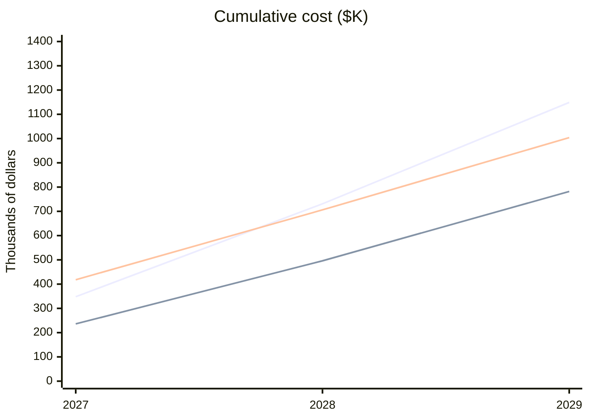

# Observability Stack for 2027

**Copperleaf Insurance · SRE team · Prepared for the budget meeting**

> **Recommendation: Grafana Cloud.** It is the cheapest option once staff time is counted, at $782K over three years, and it keeps our dashboards portable.

## Our footprint

- **340** hosts
- **2.1 TB** of logs ingested per month
- **14** engineers on call

Options considered: **Datadog**, **Grafana Cloud**, and **Self-hosted** (Prometheus, Loki and Grafana on our own Kubernetes).

## Comparison table

| Option | Setup effort | Alerting | Log search | Lock-in | Annual cost |
|---|---|---|---|---|---|
| Datadog | Low | Excellent | Excellent | High | $348,000 |
| Grafana Cloud | Low | Good | Good | Medium | $236,000 |
| Self-hosted | High | Good | Fair | Low | $148,000 + 1.5 engineers |

## Three-year cost

Cumulative cost in thousands of dollars. The Self-hosted figures include staff time for 1.5 engineers.

| Year | Datadog | Grafana Cloud | Self-hosted (incl. staff) |
|---|---|---|---|
| 2027 | $348K | $236K | $418K |
| 2028 | $731K | $496K | $706K |
| 2029 | $1,149K | $782K | $1,004K |

Grafana Cloud stays the cheapest in every year. Self-hosted only pulls ahead of Datadog from 2028 on.

## Pros and cons

### Datadog

- **Pro:** best alerting and log search of the three
- **Pro:** low setup effort
- **Con:** most expensive, at $1.15M over three years
- **Con:** high lock-in

### Grafana Cloud

- **Pro:** lowest total cost
- **Pro:** low setup effort
- **Pro:** dashboards are portable to self-hosted Grafana
- **Con:** alerting and log search are good, not excellent

### Self-hosted

- **Pro:** lowest license cost and lowest lock-in
- **Con:** high setup effort
- **Con:** needs 1.5 additional engineers
- **Con:** weakest log search

## Recommendation

**Grafana Cloud.** Once staff time is counted it is the cheapest option, and it keeps our dashboards portable if we later move to self-hosting.

> **Note:** The Datadog quote expires on **2026-11-30**. The Self-hosted figures assume we can hire 1.5 engineers, and that headcount is not yet approved.
