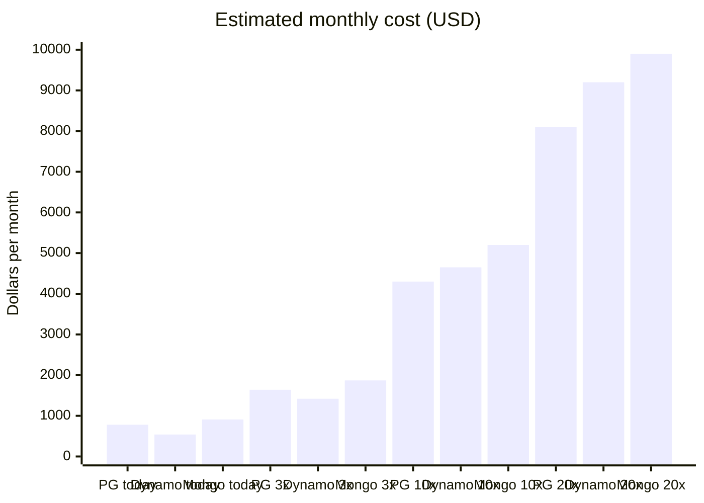

# Database for the Member-Profile Service

**Lattice Fitness · Accounts team · Decision due 2026-11-04**

> **Recommendation: PostgreSQL (RDS).** Admin search needs flexible queries, and at our realistic 3x horizon PostgreSQL costs within $220 a month of DynamoDB.

## Workload

| | |
|---|---|
| Member profiles | 9 million, about 2 KB each |
| Peak reads | 3,500 per second |
| Peak writes | 220 per second |
| Access pattern | Mostly key lookups, plus a few admin searches by email and gym |

Options considered: **PostgreSQL (RDS)**, **DynamoDB** and **MongoDB Atlas**.

## Comparison

| Option | Query flexibility | Scaling model | Ops effort | Multi-region |
|---|---|---|---|---|
| PostgreSQL (RDS) | High | Vertical plus read replicas | Medium | Read replicas only |
| DynamoDB | Low | Automatic | Low | Global tables |
| MongoDB Atlas | Medium | Sharding | Medium | Global clusters |

## Cost at scale

Estimated monthly cost in dollars at four traffic levels.

| Traffic level | PostgreSQL | DynamoDB | MongoDB Atlas |
|---|---|---|---|
| Today | $780 | $540 | $910 |
| 3x traffic | $1,640 | $1,420 | $1,870 |
| 10x traffic | $4,300 | $4,650 | $5,200 |
| 20x traffic | $8,100 | $9,200 | $9,900 |

DynamoDB is cheapest today and at 3x. At 10x and 20x, PostgreSQL is the cheapest. MongoDB Atlas is the most expensive at every level.

## Pros and cons

### PostgreSQL (RDS)

**Pros**
- Handles admin searches by email and gym with ordinary indexes
- Cheapest of the three at 10x traffic
- Familiar SQL tooling

**Cons**
- Scales vertically, with read replicas for reads
- Multi-region limited to read replicas

### DynamoDB

**Pros**
- Cheapest today and at 3x
- Scales automatically, with low ops effort
- Global tables for multi-region

**Cons**
- Low query flexibility; admin search would need extra indexes or a separate search store
- Overtakes PostgreSQL on cost at 10x

### MongoDB Atlas

**Pros**
- Medium query flexibility with a flexible document model
- Global clusters for multi-region

**Cons**
- Most expensive at every traffic level
- Sharding adds operational work

## Recommendation

> **Choose PostgreSQL (RDS).** Admin search by email and gym needs flexible queries, and PostgreSQL handles them directly. At 3x traffic it costs $1,640 a month against DynamoDB's $1,420, a gap of $220.

> **Warning:** If write volume rises above 2,000 per second, we will need to revisit this decision and plan for sharding. Peak writes today are 220 per second.
