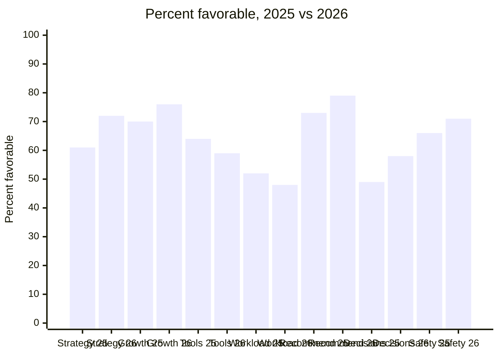

# 2026 Engagement Survey Results

**Hollow Creek Software · People Ops · Survey closed 2026-09-26**

412 of 474 employees responded.

| Response rate | Overall engagement | eNPS |
|---|---|---|
| **87%** | **74% favorable** | **31** |

## Results by question

Percent favorable, 2025 compared with 2026.

| Question | 2025 | 2026 | Change |
|---|---|---|---|
| I understand our strategy | 61% | 72% | +11 |
| My manager supports my growth | 70% | 76% | +6 |
| I have the tools to do my job | 64% | 59% | **−5** |
| Workload is sustainable | 52% | 48% | **−4** |
| I would recommend working here | 73% | 79% | +6 |
| Decisions are communicated well | 49% | 58% | +9 |
| I feel safe raising concerns | 66% | 71% | +5 |

## By department

| Department | Responses | Response rate | Engagement |
|---|---|---|---|
| Engineering | 168 | 89% | 71% |
| Sales | 92 | 81% | 77% |
| Support | 74 | 90% | 69% |
| Operations | 48 | 86% | 80% |
| G&A | 30 | 88% | 83% |

## Focus areas

Two questions declined from 2025:

- **Tools:** "I have the tools to do my job" fell from 64% to 59% favorable.
- **Workload:** "Workload is sustainable" fell from 52% to 48% favorable, and it is now the lowest-scoring question.

> **Support** has the lowest engagement of any department, at 69%. A listening session is set for **2026-10-28**.

Written comments are kept anonymous, so this page does not quote individual responses.
