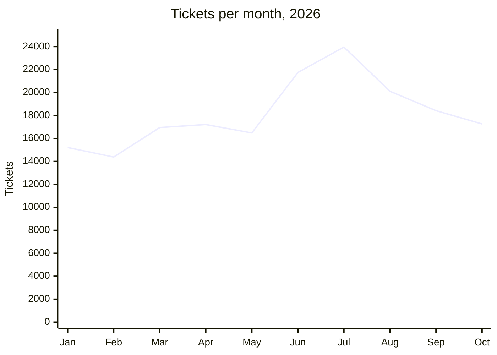
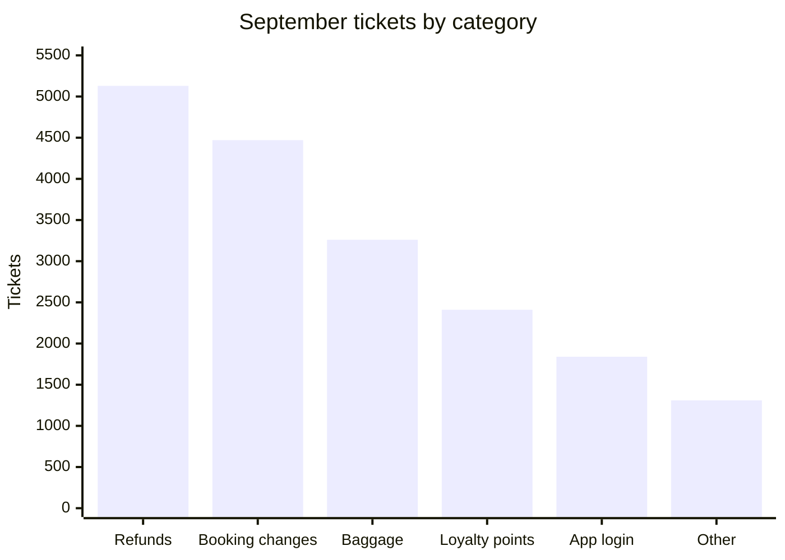

# Digital Support Summary, January to September 2026

**Gullwing Airlines · Customer Support, digital channels**

## September at a glance

| Tickets | Median first response | CSAT | Self-service deflection |
|---|---|---|---|
| **18,420** | **2.4 hours** | **4.3 / 5** | **37%** |

## Ticket volume

Volume peaked at 23,960 in July and has fallen in each month since.

## Tickets by category

September, 18,420 tickets in total.

> **Warning:** Refunds are still the largest category, at 5,130 tickets (28% of September volume), despite the new refund self-service form.

## CSAT by channel

September figures.

| Channel | Tickets | Median first response (h) | CSAT |
|---|---|---|---|
| Chat | 8,920 | 0.3 | 4.5 |
| Email | 6,140 | 6.8 | 3.9 |
| Phone callback | 2,210 | 1.1 | 4.4 |
| Social | 1,150 | 3.2 | 4.0 |
| WhatsApp | 940 | 0.5 | 4.6 |

## Notes

- The June and July spike came from the summer schedule changes.
- The new refund self-service form launched on 2026-08-12.
- Email response times remain the weakest point: 6.8 hours median first response, and the lowest CSAT of any channel at 3.9.
