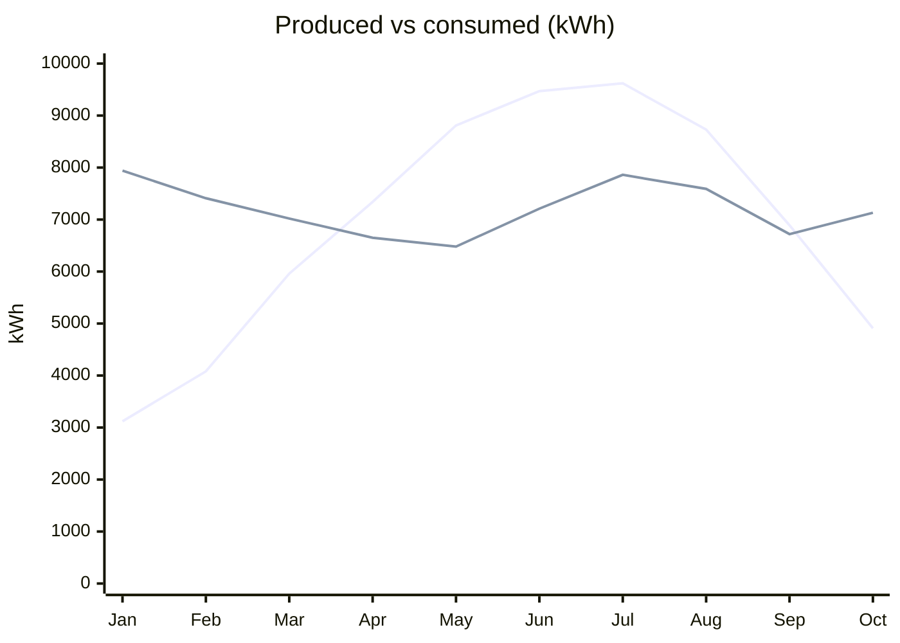

# Rooftop Solar, January to October 2026

**Brookfield Community Co-op · Facilities team · All energy figures in kWh**

| Total produced | Total consumed | Self-sufficiency | Grid credits earned |
|---|---|---|---|
| **68,930 kWh** | **72,010 kWh** | **95.7%** | **$1,184** |

## Production vs consumption

The line that rises into summer is **produced**. The flatter line, near 7,000 kWh all year, is **consumed**. Production overtook consumption in April and stayed ahead through September, then fell behind again in October.

## Monthly detail

| Month | Produced | Consumed | Net (produced minus consumed) |
|---|---|---|---|
| Jan | 3,120 | 7,940 | −4,820 |
| Feb | 4,080 | 7,410 | −3,330 |
| Mar | 5,960 | 7,020 | −1,060 |
| Apr | 7,340 | 6,650 | **+690 (surplus)** |
| May | 8,810 | 6,480 | **+2,330 (surplus)** |
| Jun | 9,470 | 7,210 | **+2,260 (surplus)** |
| Jul | 9,620 | 7,860 | **+1,760 (surplus)** |
| Aug | 8,730 | 7,590 | **+1,140 (surplus)** |
| Sep | 6,890 | 6,720 | **+170 (surplus)** |
| Oct | 4,910 | 7,130 | −2,220 |
| **Total** | **68,930** | **72,010** | **−3,080** |

April through September each ran a surplus.

## Notes

The inverter was down for 4 days in March, so March production is lower than the array would otherwise have delivered. Even so, the array covered 95.7% of what the building used over the ten months.

> **Coming up:** The board will vote on adding battery storage on **2026-11-12**.
