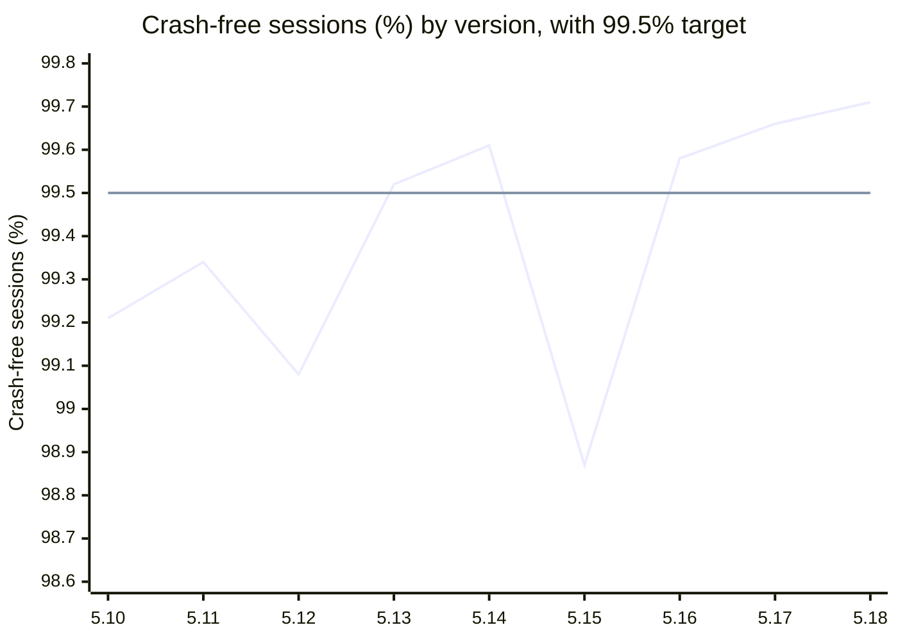

# Courier Android App: Stability by Release

**Sprocket Delivery · Mobile Platform**

| Current version | Crash-free sessions | Target | ANR rate |
|---|---|---|---|
| **5.18** | **99.71%** | **99.5%** | **0.21%** |

## Crash-free trend

The flat line is the **99.5% target**. Versions 5.13, 5.14, 5.16, 5.17 and 5.18 met it. The two dips are 5.12 and 5.15.

## Release table

| Version | Released | Crash-free sessions | Top crash |
|---|---|---|---|
| 5.10 | 2026-05-04 | 99.21% | None above 0.1 percent |
| 5.11 | 2026-05-25 | 99.34% | None above 0.1 percent |
| 5.12 | 2026-06-15 | 99.08% | Camera permission crash on the proof-of-delivery screen |
| 5.13 | 2026-07-06 | 99.52% | None above 0.1 percent |
| 5.14 | 2026-07-27 | 99.61% | None above 0.1 percent |
| 5.15 | 2026-08-17 | 98.87% | Offline map tile cache overflow |
| 5.16 | 2026-09-07 | 99.58% | None above 0.1 percent |
| 5.17 | 2026-09-28 | 99.66% | None above 0.1 percent |
| 5.18 | 2026-10-19 | **99.71%** | — |

## Top issues

- **5.12: camera permission crash** on the proof-of-delivery screen.
- **5.15: offline map tile cache overflow**, which caused the lowest crash-free rate in the period, at 98.87%.

> **5.15 was halted at 20% rollout** and replaced by 5.16 three weeks later, on 2026-09-07.
