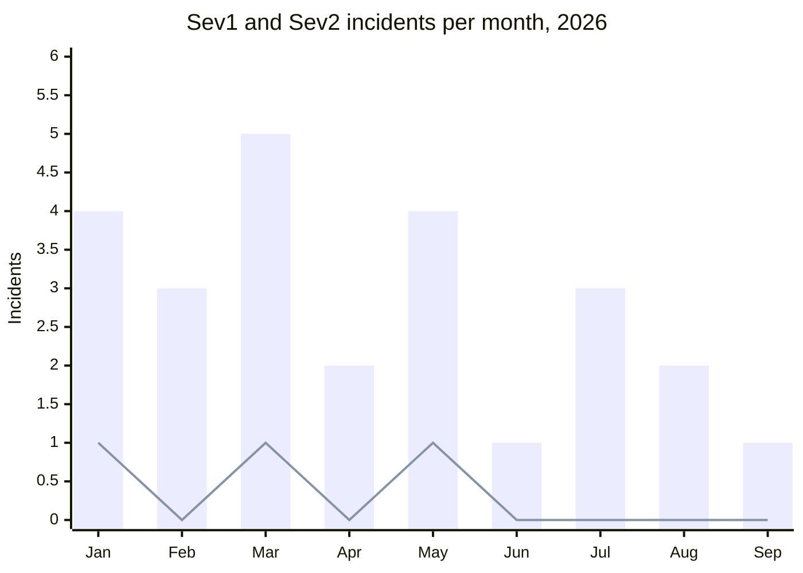

# Days without a Sev1

Fernhill Labs, SRE

# 143

**days since the last Sev1**, which was the search outage on 2026-05-26

## Sev1 and Sev2 incidents by month, 2026

Sev2 is the bars. Sev1 is the line.

## Longest streaks

- Current streak: **143 days**
- Previous record: **97 days** (2025)
- Runner-up: **64 days** (2024)

> The streak counter resets only on a declared Sev1, not on Sev2s. Any engineer can declare one from the #incidents channel.
