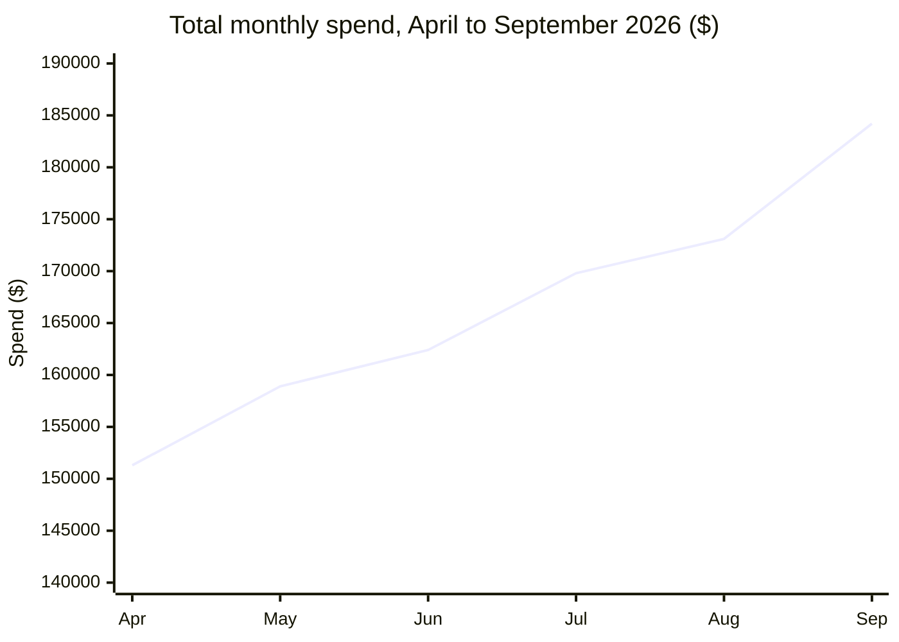
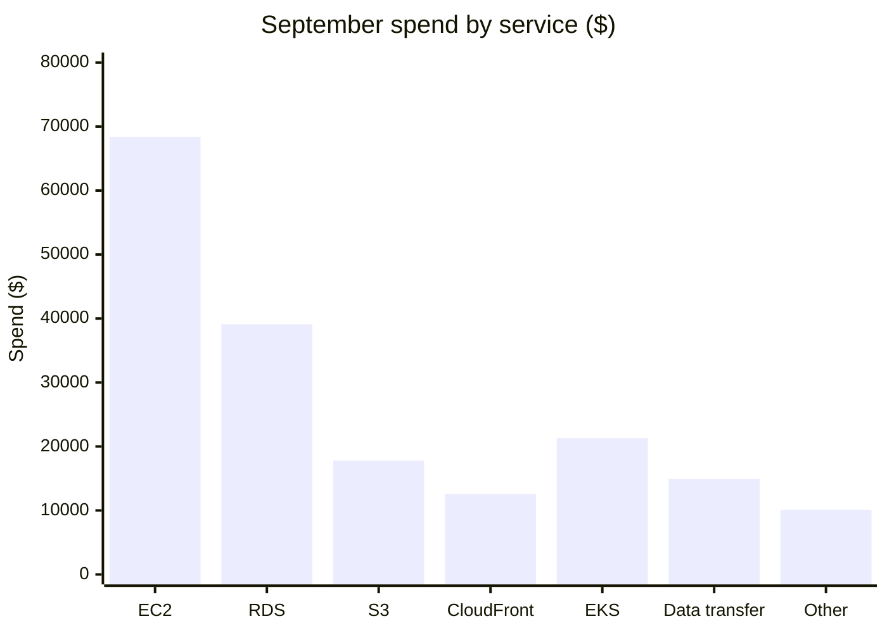

# Cloud cost dashboard: Retail Engineering

Halcyon Stores. April to September 2026.

| September spend | Month over month | Budget | Savings Plan coverage |
|:---:|:---:|:---:|:---:|
| **$184,200** | **+6.4%** | **$190,000** | **71%** |

## Monthly spend

## September by service

The seven services sum to $184,200.

## Cost anomalies

| Date | Service | Team | Excess ($) | Cause |
|---|---|---|---:|---|
| 2026-09-08 | EC2 | Search | 4,200 | Forgotten load-test fleet |
| 2026-09-17 | Data transfer | Media | 2,900 | Cross-region replication misconfigured |
| 2026-09-25 | RDS | Billing | 1,700 | Oversized snapshot retention |

> **Warning: October is at risk of exceeding budget.** At the current growth rate, October spend will exceed the $190,000 budget. Teams should review the rightsizing report by **2026-10-24**.
