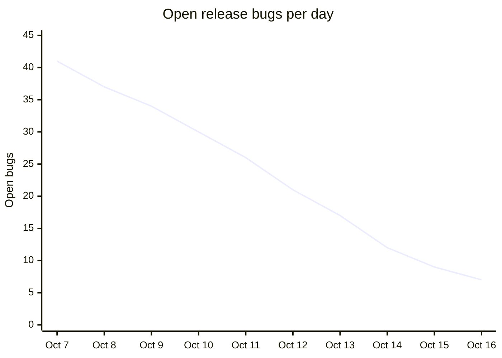

# Atlas 4.2.0 go/no-go

Target release 2026-10-22. Owner: Release Council.

> **Recommendation: Conditional go.** Provided the blockers clear by 2026-10-20.

| Open blockers | Crash-free sessions (beta) | Test pass rate | Days to release |
|:---:|:---:|:---:|:---:|
| **3** | **99.71%** | **96.4%** | **6** |

## Readiness checklist

| Area | Owner | Status | Notes |
|---|---|---|---|
| Feature complete | Ana Brooks | Ready | All 12 epics merged |
| Regression suite | QA Guild | Ready | 1,842 of 1,911 tests passing |
| Accessibility audit | Kofi Mensah | Not ready | 2 contrast issues open |
| Localization | Ines Duarte | Ready | 14 languages signed off |
| Store listing | Growth team | Not ready | Tablet screenshots pending |
| Rollback plan | Ana Brooks | Ready | Staged rollout starting at 5% |

## Bug burndown

Open release bugs per day.

## Blockers

1. Two accessibility contrast issues on the checkout screen: one on the price label, one on the disabled button.
2. Missing store screenshots for tablets.
3. Third blocker as listed in the tracker; the two items above are the known ones.
