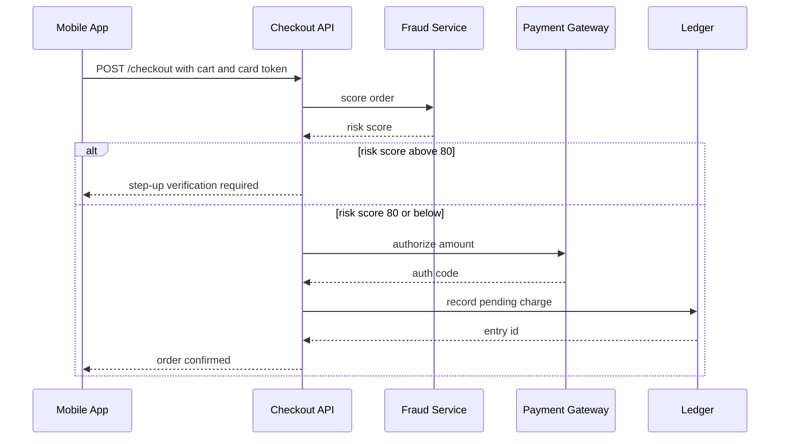
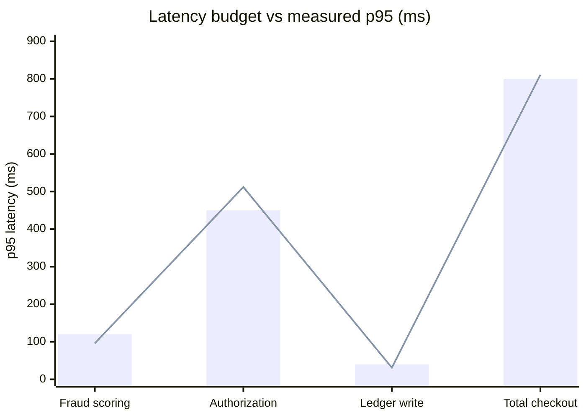

# In-app checkout payment flow

Payments Engineering, Tidewater Grocers. Design v2, dated 2026-09-22.

## Payment sequence

When the risk score is above 80, the Checkout API asks for step-up verification and does not call the Payment Gateway.

## Latency budget

| Step | p95 budget (ms) | Measured p95 (ms) |
|---|---:|---:|
| Fraud scoring | 120 | 96 |
| Authorization | 450 | 512 |
| Ledger write | 40 | 31 |
| Total checkout | 800 | 811 |

The bars are the p95 budget. The line is the measured p95.

## Open issues

> **Warning: Authorization is over budget by 62 ms.** The gateway's us-east endpoint is called from us-west-2.

Next steps:

- Move to the gateway's regional endpoint.
- Add a 2 second timeout with one retry.
- Alert when total p95 exceeds 800 ms.
