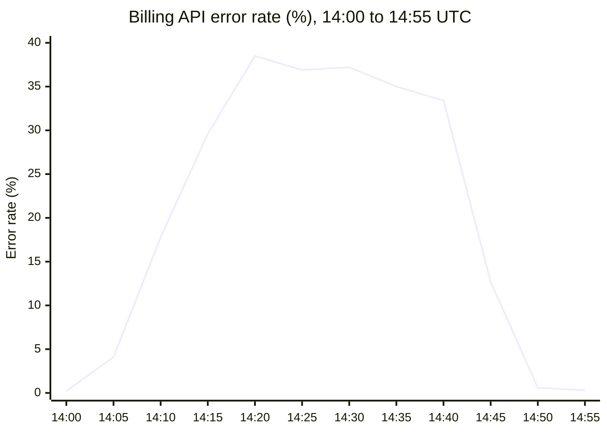

# INC-2291: Billing API outage

Brightwave Telecom. Owner: Billing Platform team. Incident date 2026-09-03.

| Duration | Peak error rate | Failed requests | Customers affected |
|:---:|:---:|:---:|:---:|
| **47 min** | **38.5%** | **182,400** | **12,900** |

## Summary

A config change lowered the database connection pool from 200 to 20. Requests queued and timed out. The change was rolled back.

## Timeline

| Time (UTC) | Event |
|---|---|
| 14:02 | Config change merged and deployed |
| 14:06 | Error rate alert fires |
| 14:09 | On-call acknowledges |
| 14:21 | Incident declared Sev2 |
| 14:33 | Connection pool exhaustion identified |
| 14:41 | Rollback started |
| 14:49 | Errors return to baseline |
| 14:53 | Incident resolved |

## Error rate

Error rate in percent, at 5 minute intervals.

## Root cause

A config change lowered the database connection pool size from 200 to 20. Under production load, the smaller pool was exhausted. Requests queued behind it and timed out.

> **Gap:** The config linter did not validate pool size bounds, so the change passed review and deployment.

## Action items

| Action | Owner | Due |
|---|---|---|
| Add bounds validation for pool settings | Marta Kowalski | 2026-09-24 |
| Canary config changes to 5 percent of pods first | Ravi Shah | 2026-10-08 |
| Alert on pool saturation above 80 percent | Billing on-call | 2026-09-17 |
