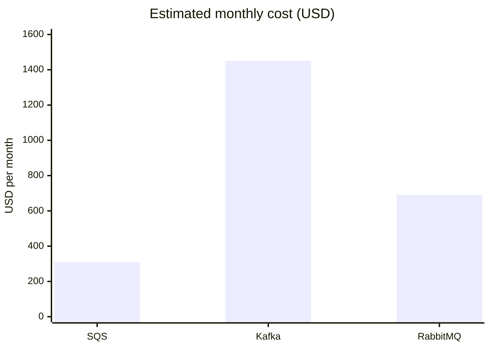

# Choosing a message queue for order routing

The Fulfillment team at Saltmarsh Foods needs a message queue for the new order-routing service. This page sets out the options for the architecture review on 2026-10-21.

## Expected load

- **Peak:** 1,800 messages per second
- **Average:** 400 messages per second
- **Message size:** under 8 KB
- **Delivery:** at-least-once is acceptable
- **Ordering:** needed only per order

## Options

- **SQS:** Amazon's fully managed queue service, with FIFO queues for ordering.
- **Kafka (Amazon MSK):** a managed Apache Kafka cluster, built around partitioned, replayable logs.
- **RabbitMQ (Amazon MQ):** a managed RabbitMQ broker, with flexible routing.

## Comparison

| Option | Ordering | Throughput ceiling | Ops burden | Replay | Monthly cost |
| --- | --- | --- | --- | --- | --- |
| SQS | FIFO per message group | Very high | None | No | $310 |
| Kafka | Per partition | Very high | High | Yes, up to retention | $1,450 |
| RabbitMQ | Per queue | Medium | Medium | No | $690 |

### Estimated monthly cost

## Pros and cons

### SQS

- Pros
  - Fully managed, and scales automatically.
  - Lowest estimated monthly cost.
- Cons
  - No replay.
  - 256 KB message limit.

### Kafka (Amazon MSK)

- Pros
  - Replay and stream processing.
  - Retained history supports new consumers.
- Cons
  - Needs partition planning.
  - Broker upgrades are our responsibility.

### RabbitMQ (Amazon MQ)

- Pros
  - Flexible routing.
  - Mid-range cost and throughput.
- Cons
  - We would own capacity planning.
  - Throughput ceiling is lower than the other two.

## Recommendation

> **Recommendation: SQS with FIFO queues keyed by order ID.**
>
> It meets the load and ordering needs at the lowest cost, with the least operational work. We will revisit this if the analytics team needs event replay in 2027.
