# Member-profile database decision

The Accounts team at Lattice Fitness needs a database for the new member-profile service. The decision is due on 2026-11-04.

## Workload

- **Profiles:** 9 million, about 2 KB each
- **Reads:** 3,500 per second at peak
- **Writes:** 220 per second at peak
- **Query pattern:** mostly key lookups, plus a few admin searches by email and gym

## Options

- **PostgreSQL (RDS)**
- **DynamoDB**
- **MongoDB Atlas**

## Comparison

| Option | Query flexibility | Scaling model | Ops effort | Multi-region |
| --- | --- | --- | --- | --- |
| PostgreSQL | High | Vertical, plus read replicas | Medium | Read replicas only |
| DynamoDB | Low | Automatic | Low | Global tables |
| MongoDB Atlas | Medium | Sharding | Medium | Global clusters |

## Cost at scale

Estimated monthly cost in US dollars at three traffic levels.

```mermaid
xychart-beta
    title "Estimated monthly cost (USD) by traffic level"
    x-axis ["Today", "3x traffic", "10x traffic"]
    y-axis "USD per month" 0 --> 5500
    bar [780, 1640, 4300]
    bar [540, 1420, 4650]
    bar [910, 1870, 5200]
```

The three bars at each level are PostgreSQL, DynamoDB and MongoDB Atlas, in that order.

| Traffic level | PostgreSQL | DynamoDB | MongoDB Atlas |
| --- | --- | --- | --- |
| Today | $780 | $540 | $910 |
| 3x traffic | $1,640 | $1,420 | $1,870 |
| 10x traffic | $4,300 | $4,650 | $5,200 |

## Pros and cons

### PostgreSQL (RDS)

- Pros
  - Flexible queries, which the admin search needs.
  - Familiar operational model.
- Cons
  - Scales vertically, with read replicas only for multi-region reads.
  - Medium ops effort.

### DynamoDB

- Pros
  - Automatic scaling and low ops effort.
  - Global tables for multi-region.
- Cons
  - Low query flexibility for the admin search.
  - Cost overtakes PostgreSQL at higher traffic.

### MongoDB Atlas

- Pros
  - Medium query flexibility.
  - Global clusters for multi-region.
- Cons
  - Highest cost at every traffic level.
  - Sharding adds operational work.

## Recommendation

> **Recommendation: PostgreSQL.**
>
> Admin search needs flexible queries. At our realistic 3x horizon, PostgreSQL costs within $220 a month of DynamoDB.

> **Warning: revisit sharding above 2,000 writes per second.**
>
> Write volume above 2,000 per second would force us to revisit sharding.
