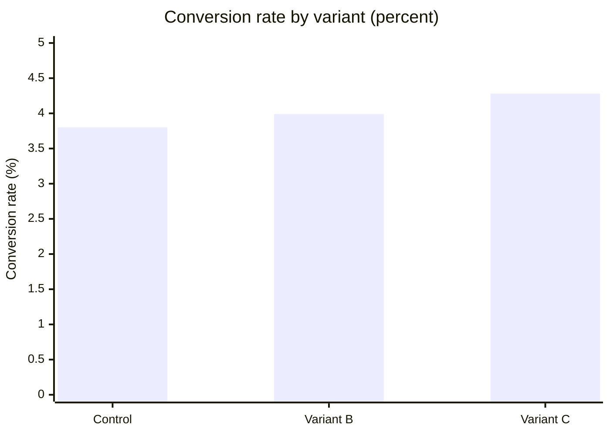
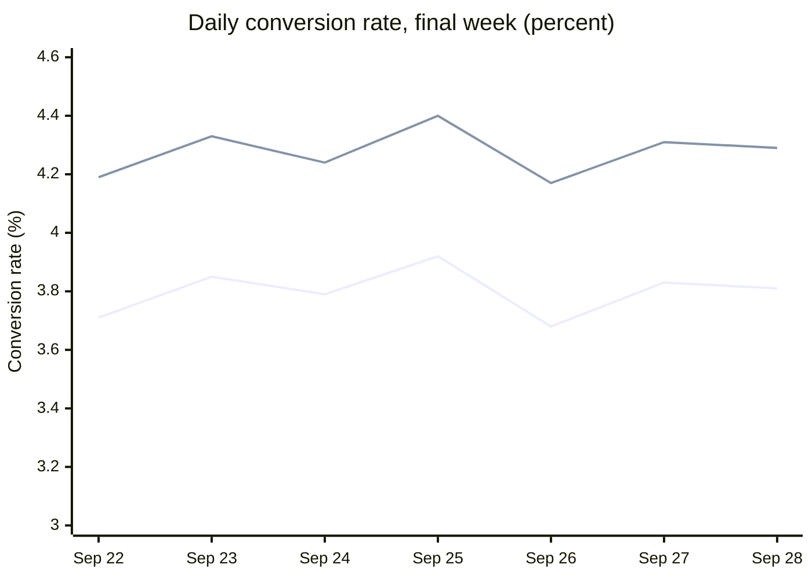

# Experiment EXP-418: checkout button copy

Growth Analytics at Marigold Home ran experiment EXP-418 from 2026-09-08 to 2026-09-28. It tested the copy on the checkout button.

## Headline figures

- **Total visitors:** 144,607
- **Winner:** Variant C
- **Lift:** +12.6 percent
- **Confidence:** 99.7 percent

## Variants

- **Control:** "Place order"
- **Variant B:** "Complete purchase"
- **Variant C:** "Pay securely now"

## Results

| Variant | Visitors | Conversions | Conversion rate | Lift vs control | p-value |
| --- | --- | --- | --- | --- | --- |
| Control | 48,210 | 1,832 | 3.80 percent | None | None |
| Variant B | 48,095 | 1,919 | 3.99 percent | +5.0 percent | 0.14 |
| Variant C | 48,302 | 2,068 | 4.28 percent | +12.6 percent | 0.003 |

## Conversion rate

## Daily trend

Daily conversion rate over the final week, for Control and Variant C.

The two lines are Control and Variant C, in that order. Variant C sat above Control on every day.

## Decision

> **Ship Variant C to 100 percent of traffic.**
>
> Variant B was not significant. Average order value did not change, at $87.40 for Variant C against $87.15 for Control.
