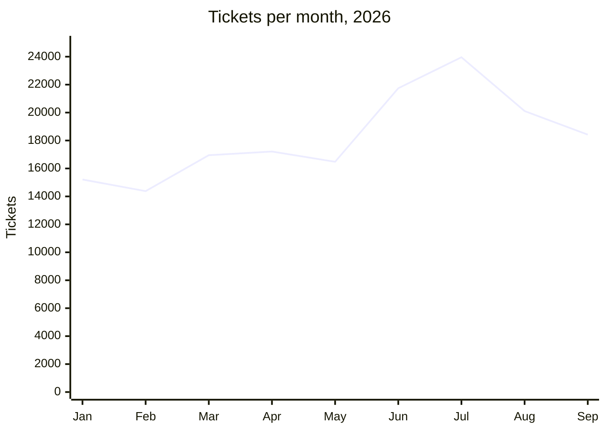
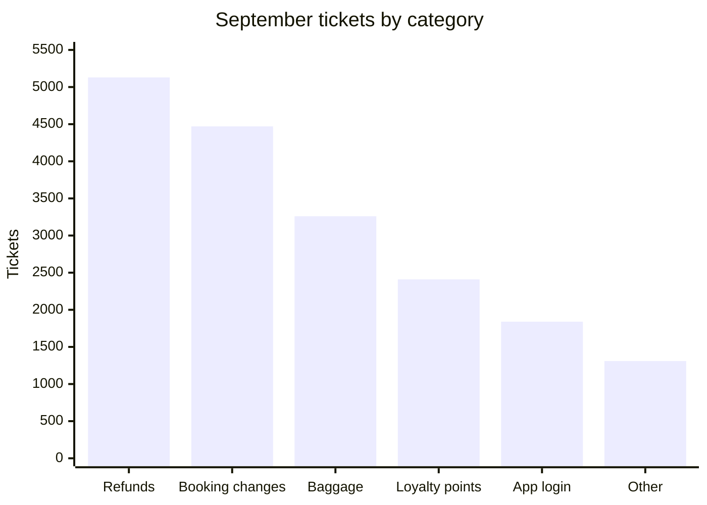

# Digital support summary, January to September 2026

Customer Support at Gullwing Airlines is publishing a summary of digital-channel support for January to September 2026.

## September at a glance

- **Tickets:** 18,420
- **Median first response:** 2.4 hours
- **CSAT:** 4.3 out of 5
- **Self-service deflection:** 37 percent

## Ticket volume

## Tickets by category, September

| Category | Tickets |
| --- | --- |
| Refunds | 5,130 |
| Booking changes | 4,470 |
| Baggage | 3,260 |
| Loyalty points | 2,410 |
| App login | 1,840 |
| Other | 1,310 |

## CSAT by channel

| Channel | Tickets | Median first response (h) | CSAT |
| --- | --- | --- | --- |
| Chat | 8,920 | 0.3 | 4.5 |
| Email | 6,140 | 6.8 | 3.9 |
| Phone callback | 2,210 | 1.1 | 4.4 |
| Social | 1,150 | 3.2 | 4.0 |

## Notes

- The June and July spike came from the summer schedule changes.
- The new refund self-service form launched on 2026-08-12.
- Email response times remain the weakest point.

> **Warning: refunds are still the largest category.**
> Refunds led September with 5,130 tickets, despite the new refund form.
