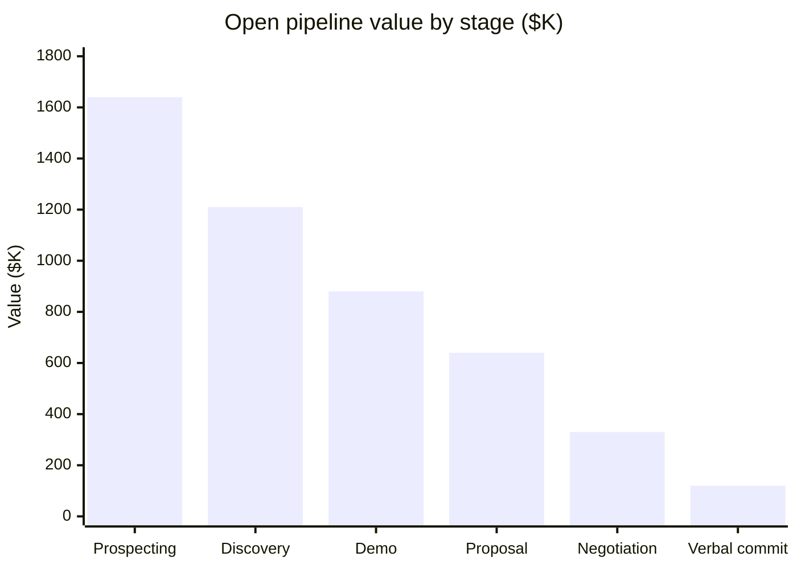

# Q4 2026 Pipeline: Mid-Market

**Northwind Analytics** · as of 2026-10-14

| Total pipeline | Weighted pipeline | Quota | Win rate |
| :---: | :---: | :---: | :---: |
| **$4,820K** | **$1,930K** | **$2,400K** | **27%** |

## Pipeline by stage

| Stage | Deals | Value ($K) |
| --- | ---: | ---: |
| Prospecting | 82 | 1,640 |
| Discovery | 51 | 1,210 |
| Demo | 34 | 880 |
| Proposal | 19 | 640 |
| Negotiation | 9 | 330 |
| Verbal commit | 4 | 120 |
| **Total** | **199** | **4,820** |

## Top deals

| Account | Owner | Stage | Value ($K) | Close date |
| --- | --- | --- | ---: | --- |
| Halvorsen Freight | Jamie Okafor | Negotiation | 210 | 2026-11-21 |
| Brightline Clinics | Sara Lindqvist | Proposal | 185 | 2026-12-05 |
| Cobalt Mining Co | Jamie Okafor | Verbal commit | 120 | 2026-10-31 |
| Fernwood Schools | Luis Ortega | Demo | 96 | 2026-12-12 |

## Forecast notes

Weighted pipeline of $1,930K covers 80% of the $2,400K quota. To be safe, the team needs roughly $470K of new weighted pipeline before mid-November.

> **Coverage gap: about $470K of weighted pipeline**
>
> Add roughly **$470K** of new weighted pipeline before **2026-11-15** to close the gap to quota.
