# Days without a Sev1

Fernhill Labs SRE

# 143 days

**since the last Sev1 incident**, the search outage on 2026-05-26.

## Sev1 and Sev2 incidents per month, 2026

The first bar in each month is Sev1, the second is Sev2.

```mermaid
xychart-beta
    title "Incidents per month, 2026 (Sev1, Sev2)"
    x-axis [Jan, Feb, Mar, Apr, May, Jun, Jul, Aug, Sep]
    y-axis "Incidents" 0 --> 6
    bar [1, 0, 1, 0, 1, 0, 0, 0, 0]
    bar [4, 3, 5, 2, 4, 1, 3, 2, 1]
```

| Month | Jan | Feb | Mar | Apr | May | Jun | Jul | Aug | Sep |
| --- | ---: | ---: | ---: | ---: | ---: | ---: | ---: | ---: | ---: |
| Sev1 | 1 | 0 | 1 | 0 | 1 | 0 | 0 | 0 | 0 |
| Sev2 | 4 | 3 | 5 | 2 | 4 | 1 | 3 | 2 | 1 |

## Longest streaks

- **Current streak:** 143 days
- **Previous record:** 97 days (2025)
- **Runner-up:** 64 days (2024)

> **Good to know:** the streak counter resets only on a declared Sev1, not on Sev2s. Any engineer can declare one from the **#incidents** channel.
