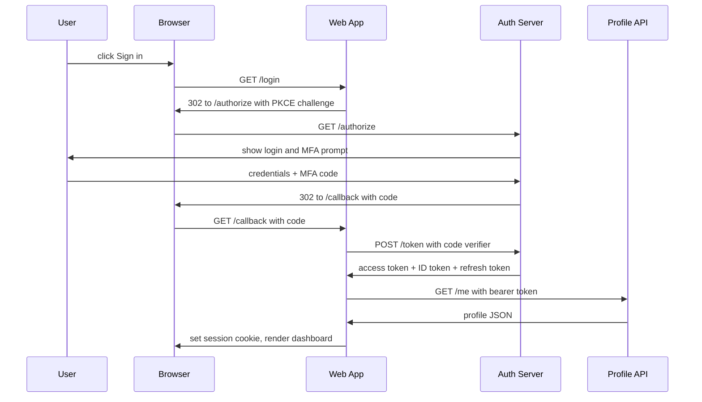

# Member Portal Login

**Pinecrest Credit Union** · Identity team · Draft, 2026-10-08

## Login flow

Members sign in with the OAuth 2.0 authorization code flow with PKCE. The Web App holds every token server-side; the browser only ever gets a session cookie.

## Tokens

| Token | Lifetime | Stored where |
| --- | --- | --- |
| Access token | 15 minutes | Server-side session |
| ID token | 15 minutes | Server-side session |
| Refresh token | 30 days | Encrypted session store |
| Session cookie | 12 hours | Browser (HttpOnly, Secure) |

## Security notes

- **PKCE is mandatory** on every authorization request.
- **MFA is required** for every member.
- **Account lockout:** failed logins lock the account after 5 attempts.

> **Warning:** tokens must never be exposed to browser JavaScript or kept in browser storage (localStorage, sessionStorage, IndexedDB). The browser holds only the HttpOnly session cookie.
