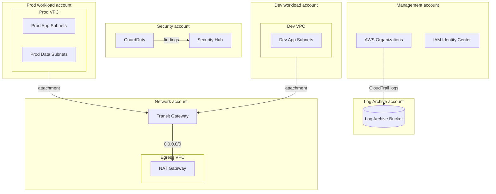

# AWS Landing Zone

**Meridian Logistics** · Cloud Foundations team · as of 2026-10-05

## Account structure

## Network ranges

| VPC | Account | CIDR | Region |
| --- | --- | --- | --- |
| Egress VPC | Network | 10.0.0.0/20 | us-west-2 |
| Prod VPC | Prod workload | 10.10.0.0/16 | us-west-2 |
| Dev VPC | Dev workload | 10.20.0.0/16 | us-west-2 |

> **Note:** Prod and Dev VPCs cannot route to each other. The Transit Gateway keeps them on separate route tables, **rt-prod** and **rt-dev**.

## Guardrails

Service control policies applied across the organization:

- **Deny leaving the organization.**
- **Deny disabling CloudTrail.**
- **Deny regions other than** us-west-2 and us-east-1.
- **Deny root user access keys.**
