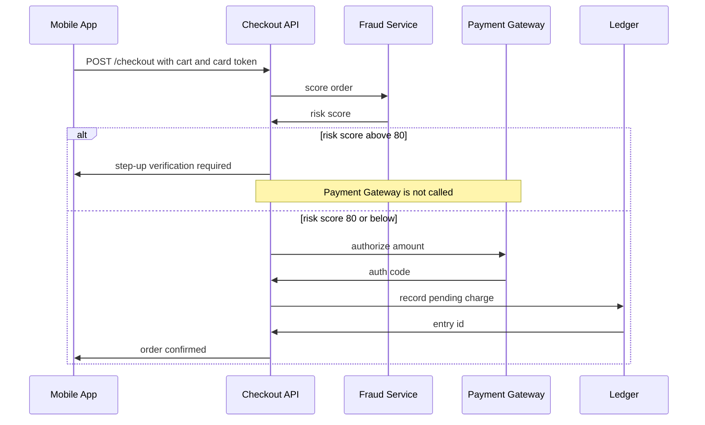

# Checkout Payment Flow

**Tidewater Grocers** · Payments Engineering · Version 2, 2026-09-22

## Payment sequence

## Latency budget

| Step | p95 budget (ms) | Measured p95 (ms) |
| --- | ---: | ---: |
| Fraud scoring | 120 | 96 |
| Authorization | 450 | **512** |
| Ledger write | 40 | 31 |
| Total checkout | 800 | **811** |

The first bar in each pair is the budget, the second is the measured p95.

```mermaid
xychart-beta
    title "p95 latency: budget vs measured (ms)"
    x-axis ["Fraud scoring", "Authorization", "Ledger write", "Total checkout"]
    y-axis "p95 (ms)" 0 --> 900
    bar [120, 450, 40, 800]
    bar [96, 512, 31, 811]
```

## Open issues

> **Warning: Authorization is 62 ms over budget.**
>
> The gateway's us-east endpoint is called from us-west-2, adding cross-region latency. This pushes total checkout p95 to 811 ms, over its 800 ms budget.

Next steps:

- Move to the gateway's regional endpoint.
- Add a 2-second timeout with one retry.
- Alert when total checkout p95 exceeds 800 ms.
