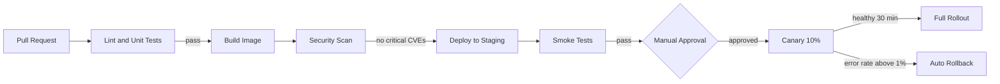
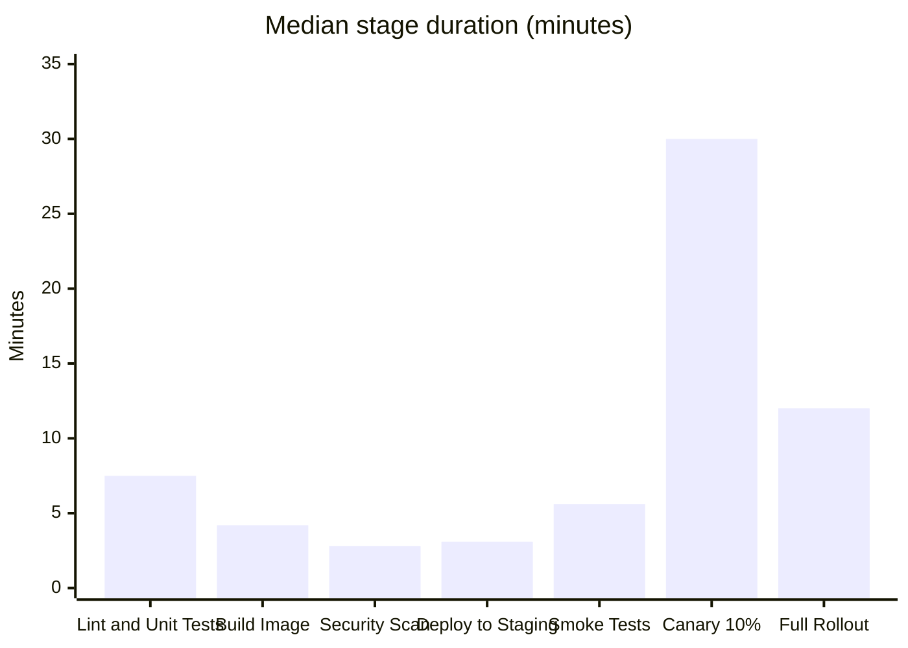

# Monorepo Deployment Pipeline

**Quillstone Software** · Developer Productivity · as of 2026-10-10

## Pipeline diagram

## Stage durations

| Stage | Median (min) | p90 (min) |
| --- | ---: | ---: |
| Lint and Unit Tests | 7.5 | 13.4 |
| Build Image | 4.2 | 6.9 |
| Security Scan | 2.8 | 4.1 |
| Deploy to Staging | 3.1 | 5.0 |
| Smoke Tests | 5.6 | 9.8 |
| Canary 10% | 30 | 30 |
| Full Rollout | 12 | 18 |

## Rules

- **Manual Approval** is required only for services tagged **tier-1**.
- **Friday deploys** after 15:00 local time are blocked.
- **Auto Rollback** pages the owning team.
