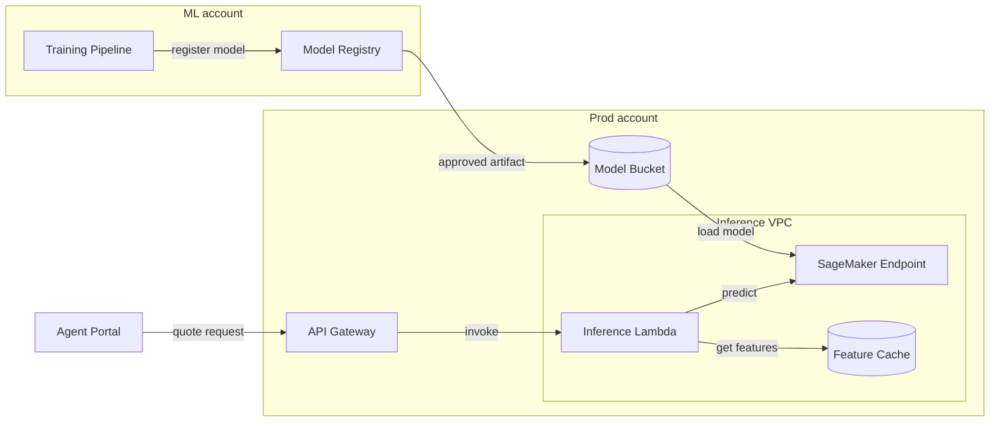

# Real-Time Quote Pricing Model

**Orchard Insurance** · ML Platform team · Reviewed 2026-10-12

## Overview

The quote pricing service scores insurance quotes in real time for the Agent Portal. It prices about **450 quotes per second** at peak with a **p99 latency target of 250 ms**. Models are trained and approved in a separate ML account, then loaded into a SageMaker endpoint in production.

## Architecture diagram

> **Warning: the Feature Cache is not a source of truth.**
>
> A cache miss falls back to the policy database and adds about **90 ms** to the request.

## Capacity

| Component | Size | Scaling |
| --- | --- | --- |
| SageMaker Endpoint | ml.c6i.2xlarge | 4 to 12 instances, on invocations per instance |
| Inference Lambda | 1024 MB | 200 reserved concurrency |
| Feature Cache | cache.r7g.large | 2 replicas |

## Deployment

1. Register the model.
2. Approve it in the Model Registry.
3. Blue/green deploy, shifting 10% of traffic every 5 minutes.
4. Roll back automatically if p99 latency exceeds 250 ms.
