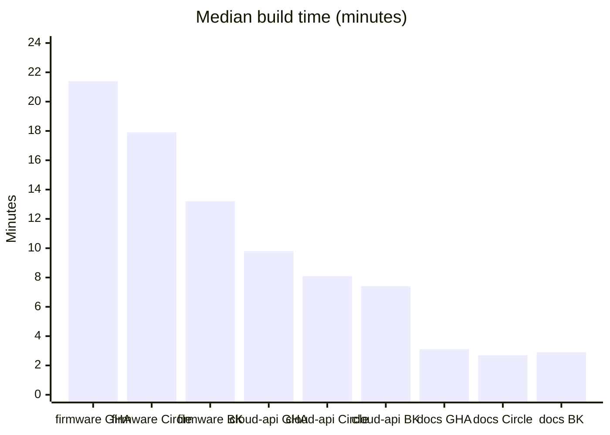

# Replacing Jenkins: CI Provider Comparison

**Ridgeback Robotics · Developer Experience**

> **Recommendation: Buildkite.** The hardware-in-the-loop lab needs self-hosted agents anyway, and Buildkite was the fastest in our benchmarks and the cheapest on license.

## Context

- About **38,000** build minutes per month
- **120** engineers across the firmware and cloud repos
- Some jobs need **ARM runners**
- Some jobs run against our **hardware-in-the-loop lab**, which needs agents inside our network

## Comparison

| Provider | Median build time (min) | ARM runners | Self-hosted agents | Monthly cost |
|---|---|---|---|---|
| GitHub Actions | 14.2 | Yes | Yes | $2,860 |
| CircleCI | 11.8 | Yes | Yes | $3,420 |
| Buildkite | 9.6 | Via our own agents | Yes (required) | $2,150 + our compute |

## Benchmarks

Median build time in minutes for our three reference pipelines on each provider.

| Pipeline | GitHub Actions | CircleCI | Buildkite |
|---|---|---|---|
| firmware-build | 21.4 | 17.9 | **13.2** |
| cloud-api-tests | 9.8 | 8.1 | **7.4** |
| docs-site | 3.1 | **2.7** | 2.9 |

Buildkite's biggest lead is on firmware-build, where it is 8.2 minutes faster than GitHub Actions. On the small docs-site pipeline, all three finish within half a minute of each other.

## Pros and cons

### GitHub Actions

**Pros**
- Lives next to our code, with no separate tool to log in to
- Hosted ARM runners available
- Supports self-hosted runners for the lab

**Cons**
- Slowest median build time, at 14.2 minutes
- Hosted minutes cost more as volume grows

### CircleCI

**Pros**
- Faster than GitHub Actions on every pipeline
- Hosted ARM runners available

**Cons**
- Most expensive, at $3,420 a month
- Lab jobs still need self-hosted runners alongside the hosted ones

### Buildkite

**Pros**
- Fastest median build time, at 9.6 minutes
- Lowest license cost
- Self-hosted agents fit the hardware-in-the-loop lab directly

**Cons**
- We pay for and run our own compute, including ARM
- We patch and maintain the agents

## Recommendation

> **Choose Buildkite.** The hardware-in-the-loop lab needs self-hosted agents whichever provider we pick. Buildkite is built around that model, it was fastest on two of our three reference pipelines, and it has the lowest license cost.

> **Warning:** Buildkite moves runner patching onto the DevEx on-call. We estimate that at **6 hours a month**.
