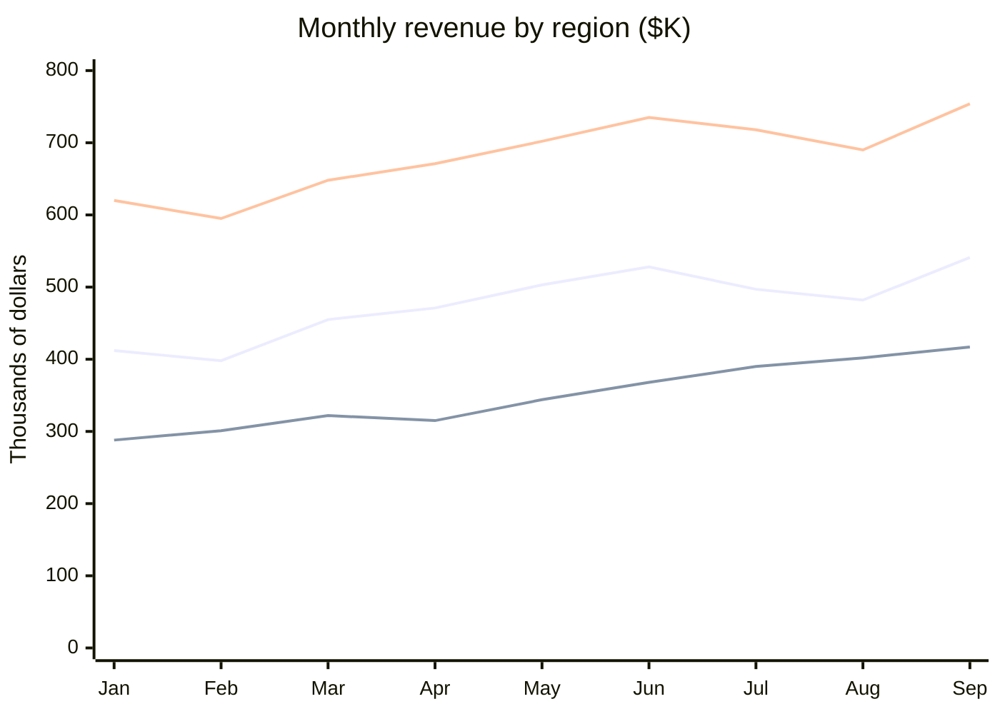

# 2026 Revenue by Region, January to September

**Vantage Outdoor Gear · Finance · All figures in thousands of dollars**

| Year-to-date revenue | Best month | APAC growth, Jan to Sep | Americas share |
|---|---|---|---|
| **$13,567K** | **September, $1,712K** | **44.8%** | **45.2%** |

> **Note:** Figures are unaudited and exclude the wholesale channel.

## Monthly revenue

From top to bottom, the lines are **Americas**, **EMEA** and **APAC**.

## Revenue table

| Month | EMEA | APAC | Americas | Total |
|---|---|---|---|---|
| Jan | 412 | 288 | 620 | 1,320 |
| Feb | 398 | 301 | 595 | 1,294 |
| Mar | 455 | 322 | 648 | 1,425 |
| Apr | 471 | 315 | 671 | 1,457 |
| May | 503 | 344 | 702 | 1,549 |
| Jun | 528 | 368 | 735 | 1,631 |
| Jul | 497 | 390 | 718 | 1,605 |
| Aug | 482 | 402 | 690 | 1,574 |
| Sep | 541 | 417 | 754 | **1,712** |
| **Year to date** | **4,287** | **3,147** | **6,133** | **13,567** |

## Highlights

- **APAC was the fastest-growing region**, rising 44.8% from $288K in January to $417K in September.
- **EMEA dipped in July and August** because of the summer sales holiday, falling from $528K in June to $482K in August, then recovered to $541K in September.
- **September was the record month**, at $1,712K across all regions.
